# Workspaces desktop

A window onto your `ws` workspaces and their Claude Code agents, like
`claude agents` with workspaces in it ([ADR 0029](../docs/adrs/0029-desktop-app.md)).

- **See every agent by status**: needs input, working, done, stopped, plus
  shell workspaces. Each shows what it's doing now, its task, its result,
  and links to the PRs it opened. The window title counts agents waiting
  for you.
- **Read the conversation**: an agent's messages, replies, and tool calls
  as a page that scrolls like any other, followed live from its transcript
  ([ADR 0030](../docs/adrs/0030-desktop-conversation-from-transcript.md)).
  Tool calls open to show their input and result. A stopped agent's
  conversation can be read without resuming it.
- **Talk to an agent**: selecting a running agent attaches to it
  (`claude attach`) behind the conversation; the Terminal toggle shows it,
  so permission prompts, slash commands, and everything else work. The
  message box below types into the same session. Detach leaves it running;
  Resume restarts a stopped one.
- **Start work**: New agent runs `ws claude` with repo specs (suggested
  from the cache), a task, a model, and a permission mode. New shell opens
  `ws shell` in a terminal; that workspace is removed when the shell exits
  or the app quits.
- **Manage**: Rename (`ws rename`: changes the name shown, never the
  workspace's directory), Stop (`claude stop`), Remove (`ws rm`, after
  confirming), and Restore stopped (`ws restore`). A workspace's name is
  the one it was created with until renamed; its id, and directory, end
  with a random suffix ([ADR 0036](../docs/adrs/0036-workspace-id-suffix-and-rename.md)).
- **Hidden workspaces**: reviews, agents started with `ws claude
  --hidden`, and anything you Hide (`ws hide`) sit in a collapsed Hidden
  group at the end of the Agents list and don't count as waiting for you.
  Open the group to see them; Unhide (`ws unhide`) puts one back
  ([ADR 0043](../docs/adrs/0043-hidden-workspaces.md),
  [design](../docs/design/hidden-workspaces/README.md)).
- **Workspace trees**: what an agent starts from its workspace, helpers and
  reviews, is its child. A child's row says `↳ <parent>`; a parent's pane
  lists the workspaces it started, with Open and Remove. Removing a parent
  lists everything that goes with it, and can keep its children instead
  (`ws rm --keep-children`)
  ([ADR 0044](../docs/adrs/0044-workspace-trees.md),
  [design](../docs/design/workspace-trees/README.md)).
- **Finished reviews clean up after themselves**: once every reviewer has
  reported, `ws` removes the review agent and its workspace. The app reads
  `ws review list`, so the pull request stays in Reviewed with its report,
  marked "agent removed after finishing", and isn't auto-reviewed again
  ([ADR 0045](../docs/adrs/0045-finished-reviews-are-removed.md)).
- **Repos**: the cached repos, grouped by host and owner, with each one's
  branches and tags, the last commit on each, and the workspaces on it
  (`ws cache list`, `ws cache refs`). Fetch one or all (`ws cache update`),
  add one with a live preview of what the spec resolves to (`ws cache
  resolve`, `ws cache add`), remove one after confirming (`ws cache
  remove`), and start an agent or shell on any repo, branch, or tag.
- **Review pull requests** (the Reviews section): watch cached GitHub repos
  and the app checks them for open pull requests with `gh`. Review starts a
  `ws claude` agent on the PR's head commit
  ([ADR 0032](../docs/adrs/0032-review-agent-per-pr-head.md)); its result
  shows under the pull request, which moves from To review to Reviewing and
  Reviewed, and is flagged when new commits arrive. Auto-review starts
  reviews by itself, within the rules and limit in Settings.

The sections are chosen from the rail on the left, or with ⌘1–⌘4, and are
designed in
[docs/design/desktop-sections](../docs/design/desktop-sections/README.md)
([ADR 0031](../docs/adrs/0031-desktop-sections-rail.md),
[ADR 0032](../docs/adrs/0032-review-agent-per-pr-head.md),
[ADR 0033](../docs/adrs/0033-ws-cache-refs.md)).

Everything goes through the `ws`, `claude`, and `gh` CLIs. The app's only
state is Reviews': watched repos, dismissals, auto-review records, and
settings, in `desktop.json` in its config directory
(`~/Library/Application Support/com.github.bobcob7.workspaces/`,
[ADR 0034](../docs/adrs/0034-desktop-state-file.md)). Checking runs in the
backend every 5 minutes by default
([ADR 0035](../docs/adrs/0035-desktop-review-checker.md)).


| A finished agent, with its result and PRs | Starting an agent |
| --- | --- |
|  |  |

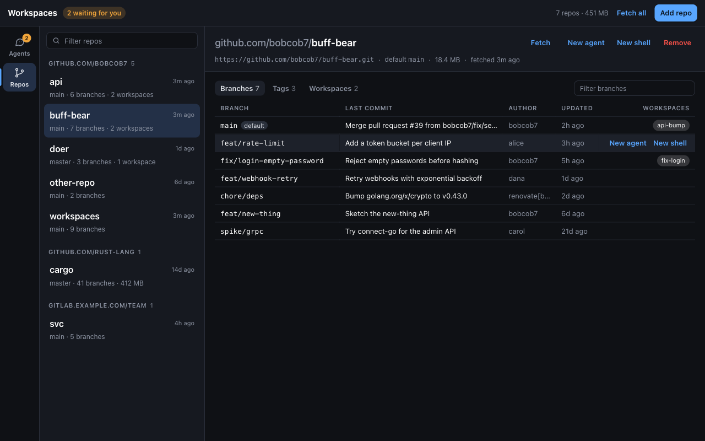

| Adding a repo | Removing a repo |
| --- | --- |
| 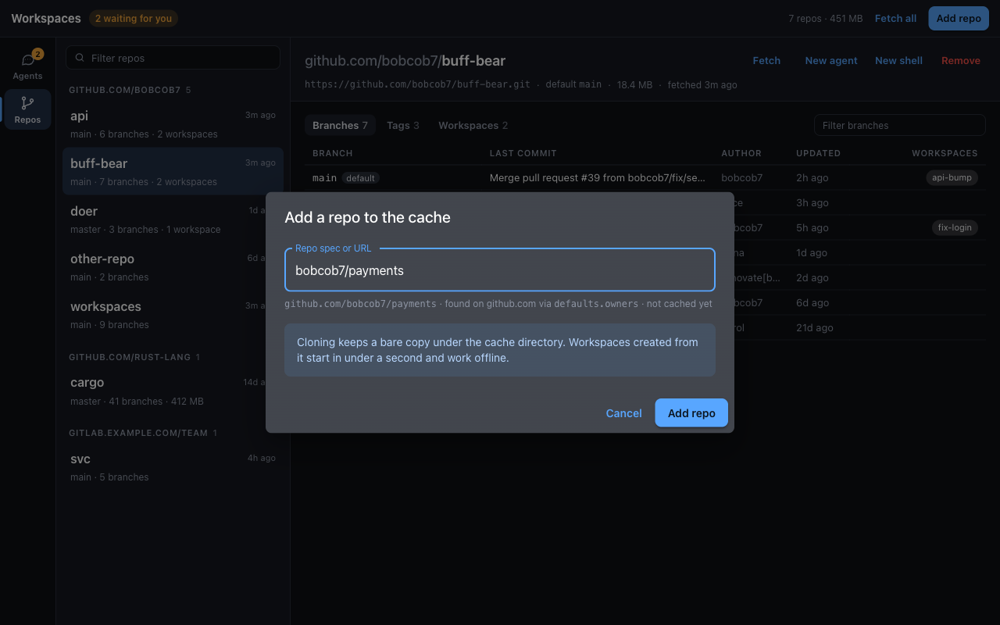 | 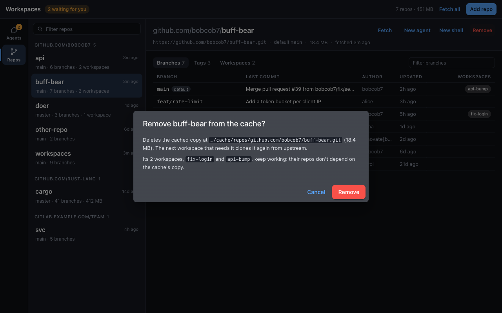 |

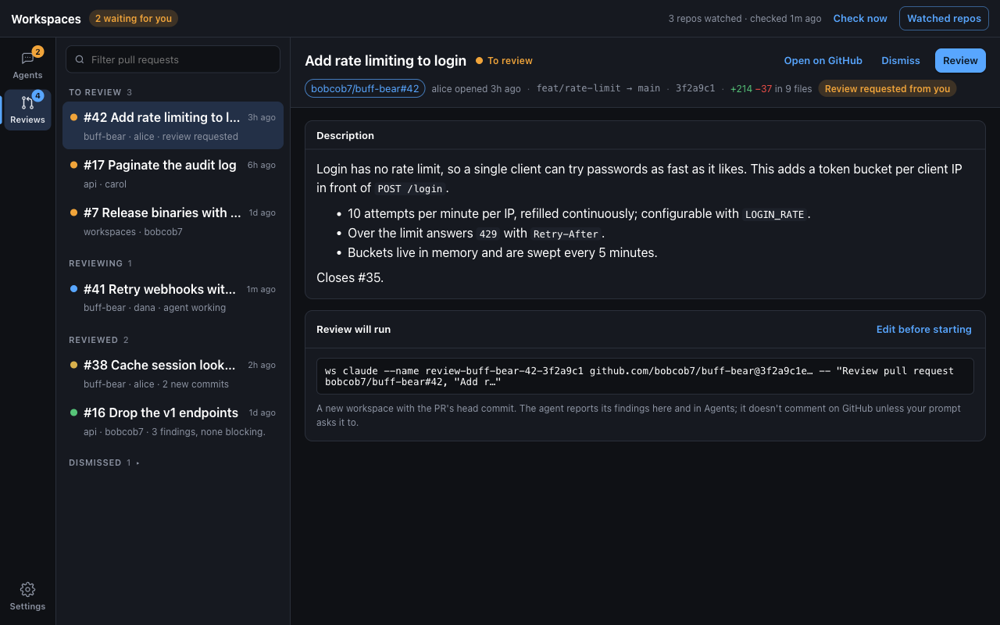

| A review out of date after new commits | Editing a review before starting it |
| --- | --- |
| 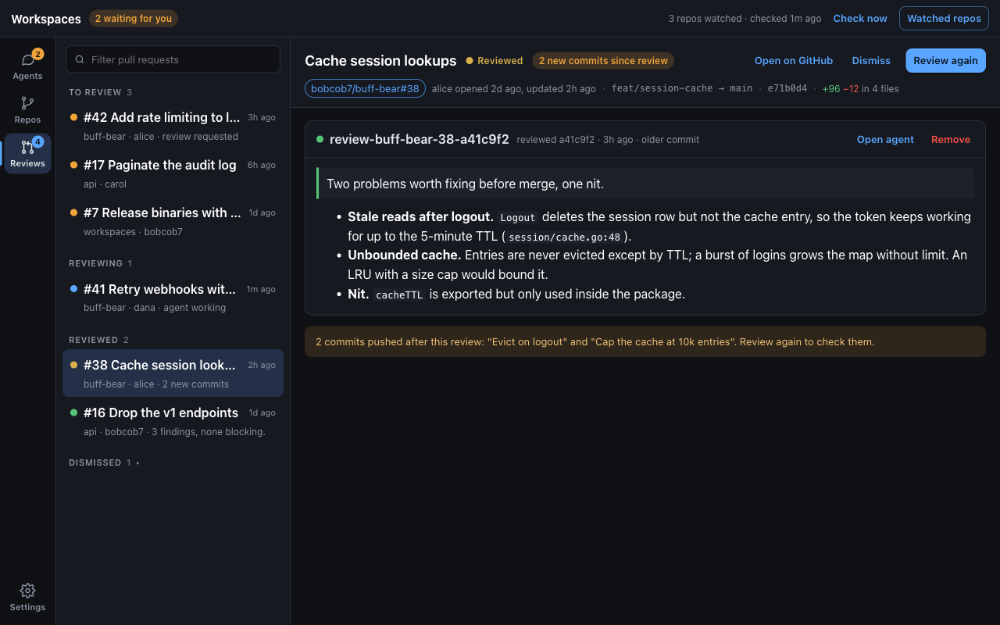 | 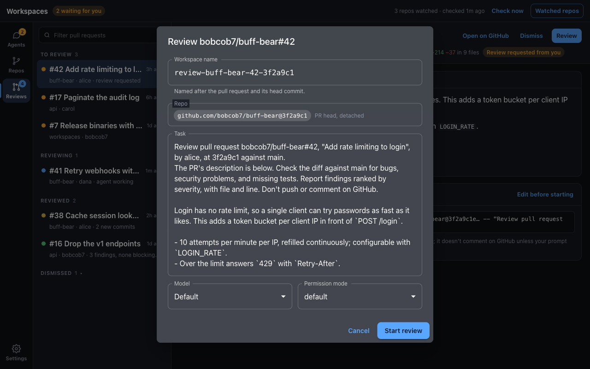 |
| **Choosing watched repos** | **Settings, Reviews group** |
| 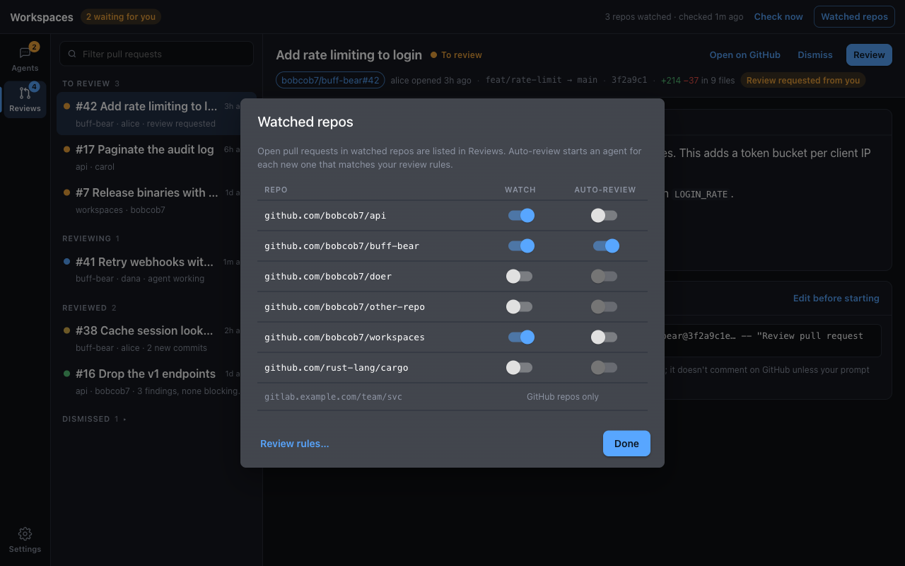 | 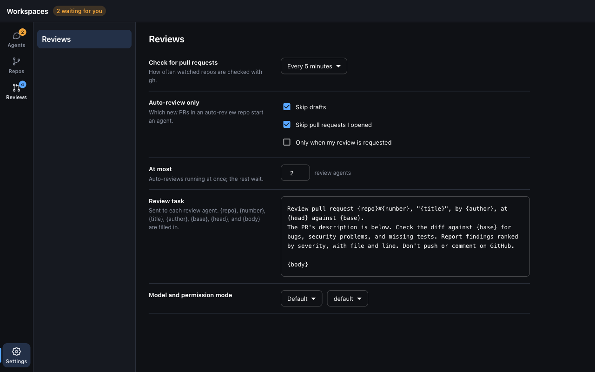 |
| **A review agent in Agents** | **Nothing watched yet, gh signed out** |
| 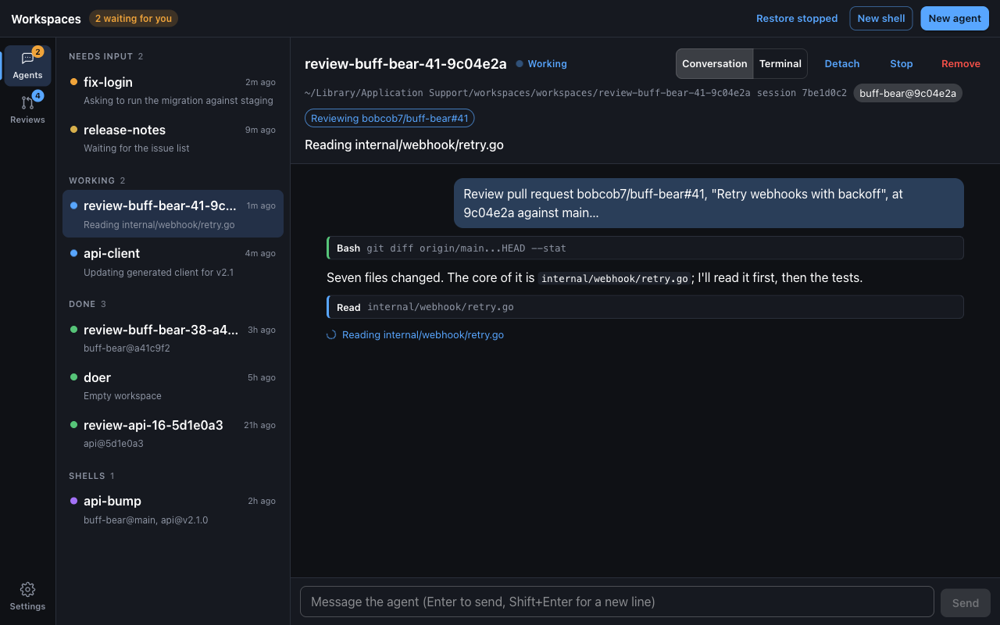 | 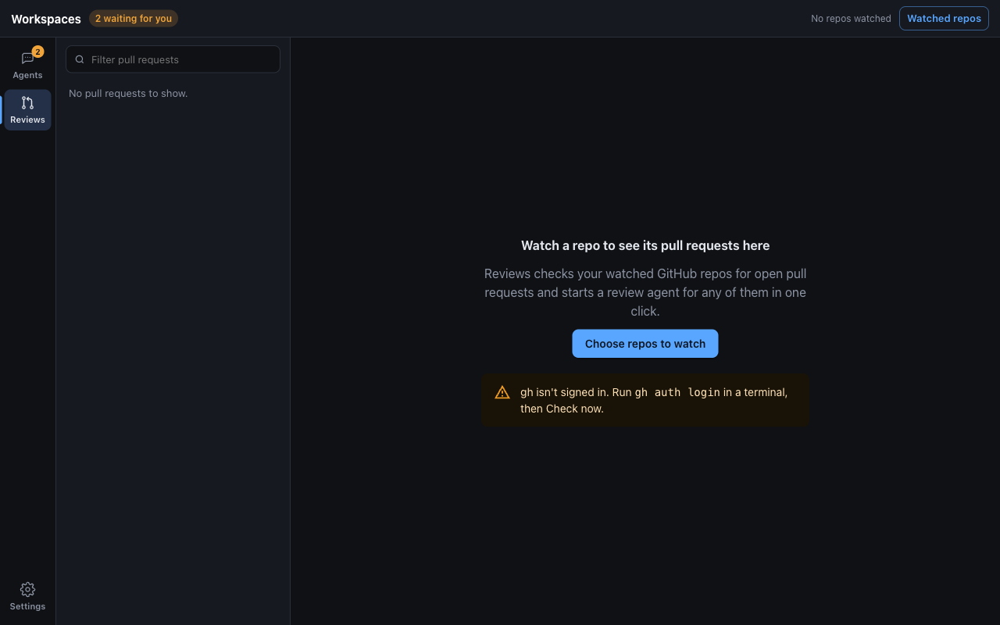 |
| **A repo's Pull request reviews card, in Repos** | **Renaming a workspace** |
| 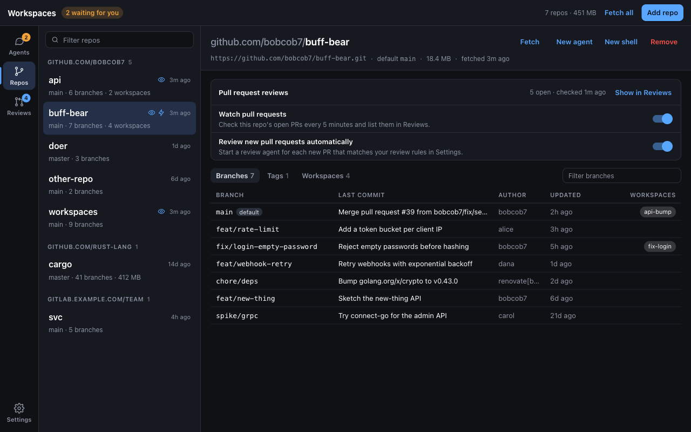 | 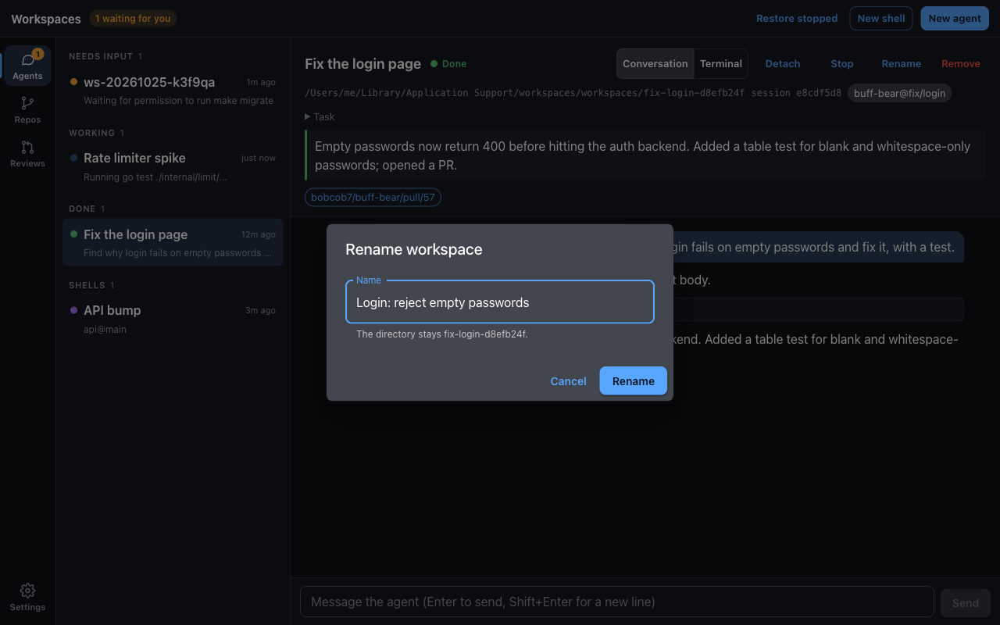 |

The screenshots use sample data.

## Requirements

- `ws` and Claude Code (2.1.302 or newer) on the PATH your login shell
  sets; the Repos section needs a `ws` with `ws cache refs`. The app asks your login shell for its PATH, then adds
  `~/.local/bin`, `~/go/bin`, `/opt/homebrew/bin`, and `/usr/local/bin`.
- For Reviews, the GitHub CLI (`gh`) signed in (`gh auth login`); the
  Reviews section says what to run if it isn't.
- The workspace root trusted in Claude Code once (see
  [`ws claude`](../docs/tools/ws-claude.md#trust)); the New agent dialog
  says how if it isn't.
- To build: Rust 1.80+, Node.js 20+, and Tauri's
  [system dependencies](https://tauri.app/start/prerequisites/).

## Build and run

```console
$ make desktop        # from the repo root: bundle in desktop/src-tauri/target/release/bundle/
$ make desktop-dev    # run with hot reload
$ make desktop-test   # typecheck, vitest, cargo test, clippy
```

`cargo test -- --ignored` in `src-tauri` also runs checks against your
real setup: `list_live` prints the listing, `attach_live` attaches to
the session in `WS_DESKTOP_ATTACH` for 4 s and detaches,
`conversation_live` prints that session's conversation, `cache_live`
prints the cache and the first repo's refs (it needs a `ws` with
`ws cache refs`), and `check_live` checks the cached repo in
`WS_DESKTOP_WATCH` with `gh` and prints its pull requests (without
auto-review).

## Layout

```
src-tauri/src/
  commands.rs   # the commands the frontend invokes
  cache.rs      # the Repos section's commands: ws cache list, refs, resolve, update, add, remove
  model.rs      # merging ws list, claude agents, and job state into entries and statuses
  jobs.rs       # Claude Code's jobs/<id>/state.json, read best-effort
  transcript.rs # a session's transcript, read into conversation items
  pty.rs        # claude attach / ws shell in a pseudo-terminal
  runner.rs     # running ws and claude, and reading ws's JSON errors
  env.rs        # the login shell's PATH
  reviews/      # Reviews: desktop.json, gh, review names, the checker, auto-review
src/
  api.ts                    # typed invoke wrappers
  features/rail/            # the section rail and ⌘1–⌘4
  features/agents/          # list, statuses, entry pane, agents slice, top-bar actions
  features/repos/           # repo list, detail with branches and tags, add and remove dialogs, repos slice
  features/conversation/    # conversation view, tool call pairing, conversations slice
  features/terminals/       # xterm.js registry, terminal view, message box, terminals slice
  features/create/          # new agent and new shell dialogs
  features/reviews/         # pull request list and detail, dialogs, the Repos slots, reviews slice
  features/settings/        # settings groups and the Reviews group
  features/ui/              # section, agent selection, dialogs, notices
```

## Status

| Shown        | When                                                            |
| ------------ | --------------------------------------------------------------- |
| Needs input  | idle, and Claude Code's job state is `blocked`                  |
| Waiting      | idle, with no clearer job state                                 |
| Working      | in the middle of a turn                                         |
| Done         | idle, and the job state is `done`                               |
| Starting     | no process yet, started under 10 s ago                          |
| Stopped      | no process; Resume or Restore stopped brings it back            |

Working, starting, and stopped come from `ws list`. The job state is
undocumented, so if Claude Code changes it, idle agents show as Waiting.
