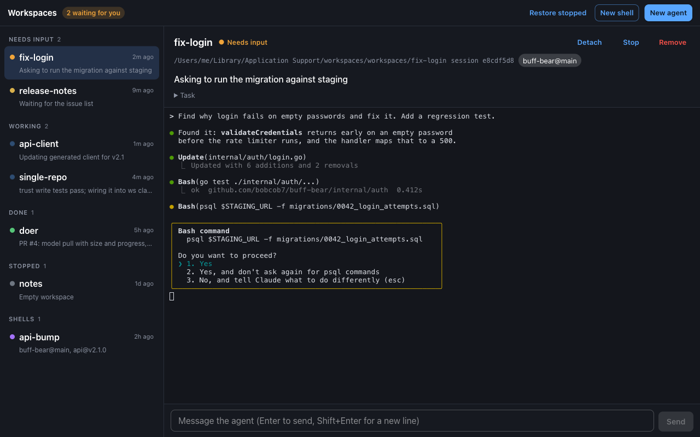
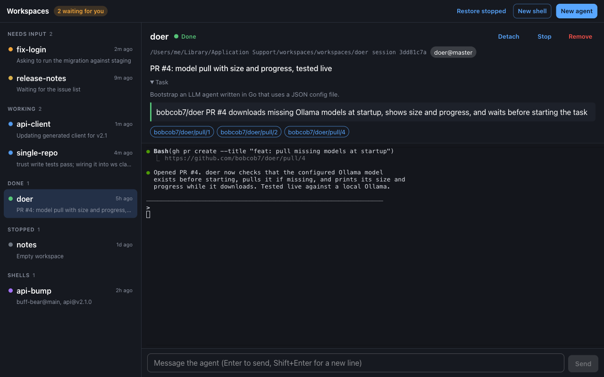
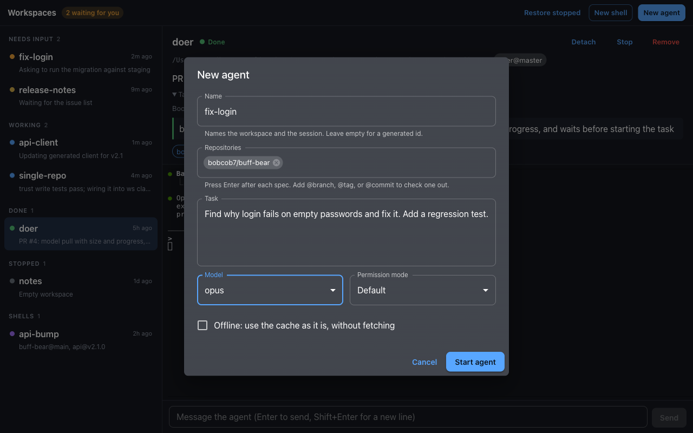

# Workspaces desktop

A window onto your `ws` workspaces and their Claude Code agents, like
`claude agents` with workspaces in it ([ADR 0029](../docs/adrs/0029-desktop-app.md)).

- **See every agent by status**: needs input, working, done, stopped, plus
  shell workspaces. Each shows what it's doing now, its task, its result,
  and links to the PRs it opened. The window title counts agents waiting
  for you.
- **Read the conversation**: an agent's messages, replies, and tool calls
  as a page that scrolls like any other, followed live from its transcript
  ([ADR 0030](../docs/adrs/0030-desktop-conversation-from-transcript.md)).
  Tool calls open to show their input and result. A stopped agent's
  conversation can be read without resuming it.
- **Talk to an agent**: selecting a running agent attaches to it
  (`claude attach`) behind the conversation; the Terminal toggle shows it,
  so permission prompts, slash commands, and everything else work. The
  message box below types into the same session. Detach leaves it running;
  Resume restarts a stopped one.
- **Start work**: New agent runs `ws claude` with repo specs (suggested
  from the cache), a task, a model, and a permission mode. New shell opens
  `ws shell` in a terminal; that workspace is removed when the shell exits
  or the app quits.
- **Manage**: Stop (`claude stop`), Remove (`ws rm`, after confirming),
  and Restore stopped (`ws restore`).

Everything goes through the `ws` and `claude` CLIs; the app keeps no state
of its own.



| A finished agent, with its result and PRs | Starting an agent |
| --- | --- |
|  |  |

The screenshots use sample data.

## Requirements

- `ws` and Claude Code (2.1.302 or newer) on the PATH your login shell
  sets. The app asks your login shell for its PATH, then adds
  `~/.local/bin`, `~/go/bin`, `/opt/homebrew/bin`, and `/usr/local/bin`.
- The workspace root trusted in Claude Code once (see
  [`ws claude`](../docs/tools/ws-claude.md#trust)); the New agent dialog
  says how if it isn't.
- To build: Rust 1.80+, Node.js 20+, and Tauri's
  [system dependencies](https://tauri.app/start/prerequisites/).

## Build and run

```console
$ make desktop        # from the repo root: bundle in desktop/src-tauri/target/release/bundle/
$ make desktop-dev    # run with hot reload
$ make desktop-test   # typecheck, vitest, cargo test, clippy
```

`cargo test -- --ignored` in `src-tauri` also runs two checks against your
real setup: `list_live` prints the listing, `attach_live` attaches to
the session in `WS_DESKTOP_ATTACH` for 4 s and detaches, and
`conversation_live` prints that session's conversation.

## Layout

```
src-tauri/src/
  commands.rs   # the commands the frontend invokes
  model.rs      # merging ws list, claude agents, and job state into entries and statuses
  jobs.rs       # Claude Code's jobs/<id>/state.json, read best-effort
  transcript.rs # a session's transcript, read into conversation items
  pty.rs        # claude attach / ws shell in a pseudo-terminal
  runner.rs     # running ws and claude, and reading ws's JSON errors
  env.rs        # the login shell's PATH
src/
  api.ts                    # typed invoke wrappers
  features/agents/          # list, statuses, entry pane, agents slice
  features/conversation/    # conversation view, tool call pairing, conversations slice
  features/terminals/       # xterm.js registry, terminal view, message box, terminals slice
  features/create/          # new agent and new shell dialogs
  features/ui/              # selection, dialogs, notices
```

## Status

| Shown        | When                                                            |
| ------------ | --------------------------------------------------------------- |
| Needs input  | idle, and Claude Code's job state is `blocked`                  |
| Waiting      | idle, with no clearer job state                                 |
| Working      | in the middle of a turn                                         |
| Done         | idle, and the job state is `done`                               |
| Starting     | no process yet, started under 10 s ago                          |
| Stopped      | no process; Resume or Restore stopped brings it back            |

Working, starting, and stopped come from `ws list`. The job state is
undocumented, so if Claude Code changes it, idle agents show as Waiting.
