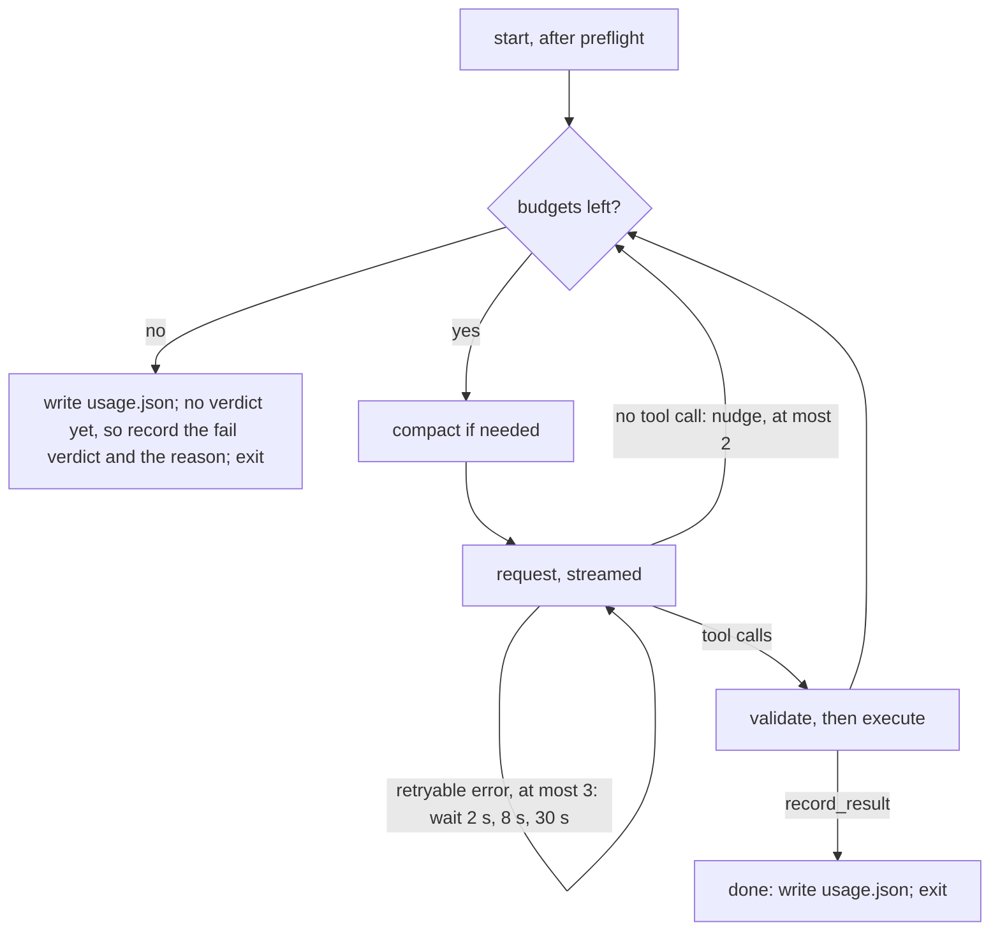

# 0065. The runner's loop: seven built-in tools plus selected MCP tools, hard budgets, deterministic context compaction, and a recorded verdict on every exit

- Status: Proposed
- Date: 2026-11-13; reworked 2026-11-14 after review (provider-neutral
  names, MCP tools, project instructions, `crashed`); revised 2026-11-14
  after the second review (budgets for the starting 9B model, tool calls
  sent as text, OpenTelemetry)

## Context

### Problem

The runner ([0062](0062-agent-runner-built-into-ws.md)) has to do an
implementer's, reviewer's or verifier's job with a model much weaker at
tool use than Claude, in a context window as small as 4k tokens by
default. Which tools does it offer, how does the loop run and stop, how
does it keep the conversation inside the window, how are the role prompts
adapted, and what must it never do?

### What a solution needs

1. **Every run ends with a verdict and a reason**, so `ws machine wait`
   never hangs and an orchestrator can tell "the model said FAIL" from
   "the endpoint died".
2. **Bounded.** Steps, wall time and tokens all have limits, and a model
   that loops is stopped.
3. **Robust to small-model failures**: malformed arguments, unknown tool
   names, text with no tool call, repeated identical calls.
4. **Fits the window** without trusting the server's silent truncation.
5. **The same role prompts** as Claude children, so roles aren't
   maintained twice.

### Relevant facts

- The starting model is `qwen/qwen3.5-9b`
  ([0064](0064-choosing-the-runner-model-and-endpoint.md)). Its card
  reports BFCL-V4 66.1, TAU2-Bench 79.1, LiveCodeBench v6 65.6 and IFEval
  91.5 in thinking mode, a native context of 262,144 tokens, and
  publishes no SWE-bench Verified score[^qwen35]. An independent
  harness measured Terminal-Bench 2.1 at 16.1 for it[^ai2-tb]. Ollama has
  open reports, for the Qwen 3.5 family, of tool calls rendered in the
  wrong format, `</think>` left unclosed in multi-turn tool history, and
  repeat and presence penalties ignored (#14493), and of `qwen3.5:9b`
  printing a `<tool_call>` as text instead of calling the tool
  (#14745)[^ollama-qwen35].
- On BFCL v4 (updated 2026-04-12), multi-turn accuracy is 68.38% for
  Claude-Opus-4.5, 47.87% for Qwen3-32B, 41.75% for Qwen3-8B, 30.00% for
  Qwen3-30B-A3B-Instruct-2507, 21.50% for Llama-3.3-70B, and 4.00% for
  Llama-3.2-3B[^bfcl].
- Open models reach 60.7% (gpt-oss-20b) to 72.2% (Devstral 2) on
  SWE-bench Verified, with each lab's own scaffold[^gptoss][^devstral2].
- Ollama silently drops a tool call whose output fails to parse (#17274),
  drops calls to tools not in the request (#19187), and has an open report
  of tool-call "flooding" in agentic sessions (#19672)[^ollama-issues].
- 4-bit quantization "amplifies tool-name hallucination … by up to 2.5×"
  while headline benchmark scores stay flat[^quant].
- Performance "significantly degrades when models must access relevant
  information in the middle of long contexts"[^litm]. Output "grows
  increasingly unreliable as input length grows" across 18
  LLMs[^context-rot].
- Ollama truncates history silently past the context
  length[^ollama-truncate], and ignores `tool_choice`[^ollama-openai].
  Other providers report an overflow as an error instead; the provider
  maps it to `ErrContextExceeded` ([0062](0062-agent-runner-built-into-ws.md)).
- The built-in roles tell the child to run `ws machine result <VERDICT>
  --file <report>` as its last step. The implementer's commit trailer
  names "Claude Haiku 5.5"[^roles].
- `internal/gate` already runs `/bin/sh -c` with a timeout, its own process
  group, and capped output[^gate].

## Decision

### Tools

Seven built-in tools, with short names and flat JSON-schema arguments. Every path is
relative to the repo directory the session starts in (the workspace's
session directory, [0028](0028-single-repo-session-directory.md)). A
result is plain text of at most 16 KiB, cut with a `[truncated: N more
bytes]` line.

| Tool | Arguments | Does |
| ---- | --------- | ---- |
| `read_file` | `path`, `offset?` (line, 1-based), `limit?` (lines, ≤ 400) | Numbered lines |
| `list_files` | `path?`, `glob?` | `git ls-files` plus untracked files not ignored; ≤ 500 entries |
| `search` | `pattern` (Go regexp), `path?`, `glob?` | `path:line: text`; ≤ 100 matches |
| `write_file` | `path`, `content` | Create or replace; makes parent directories |
| `edit_file` | `path`, `old`, `new`, `all?` | Exact replacement; `old` must occur once unless `all` |
| `run` | `command`, `timeout_seconds?` (default 120, max 900) | `/bin/sh -c` through `internal/gate`; exit code, then the last 16 KiB of stdout and stderr |
| `record_result` | `verdict`, `report` (markdown) | Records the verdict through `machine.Store`, as `ws machine result` does, and ends the run |

There's no separate git tool: git runs through `run`, as the role prompts
already assume. If the model runs `ws machine result …` through `run` and
it succeeds, the runner notices the new `result.toml` and ends the run,
like `record_result` would.

**MCP tools** are added per role, as [0069](0069-runner-mcp-tools-and-claude-code-parity.md)
decides: none by default; the role's allowed MCP tools are offered as
`mcp__<server>__<tool>`, and when there are more than the role's
`mcp_upfront` (default 8), only their names are listed in the system
message and an eighth built-in, **`tool_search`** `{query}`, loads up to 5
matching tools into the request for the rest of the run. MCP results go
through the same 16 KiB cap, tool-result framing and validation as
built-in ones.

### The loop

- **Per request**: through the endpoint's provider
  ([0062](0062-agent-runner-built-into-ws.md)), streamed where the API
  allows, with the model's `temperature` (default 0.2) and `max_output`
  (default 4096) as the output limit. The request ends at
  `request_timeout`, and a stream with no chunk for `idle_timeout` counts
  as dropped.
- **Retries**: connection refused or reset, 429, 502, 503, 504 (honouring
  `Retry-After` up to 60 s), and a dropped or stalled stream are retried up
  to 3 times, with 2 s, 8 s and 30 s backoff. Then the run stops with
  `endpoint_down`. The provider's `ErrNoTools` (Ollama's 400 `does not
  support tools`) stops with `model_no_tools`, `ErrModelMissing` (a 404
  model) with `model_missing`, and `ErrContextExceeded` triggers the
  compaction below once, then `context_overflow`.
- **Validation**: unknown tool names and arguments that aren't valid JSON,
  or fail the schema's required fields and types, are answered with a tool
  message: `error: <what>; the arguments must match: <schema>`. Three
  invalid calls in a row stop with `malformed_tool_calls`.
- **No tool call**: the runner answers `Call a tool. When the task is done,
  call record_result.`, at most twice in a row. A third time stops with
  `no_result`. When the reply's text contains `<tool_call>` (a call the
  server didn't parse, [^ollama-qwen35]), the answer is instead `Your tool
  call came back as text. Call the tool through the tools API.`; it counts
  the same. A reply with only reasoning and `max_tokens` as the stop
  reason (thinking used the output limit) is a reply with no tool call.
- **Loops**: the same tool name and arguments three times in a row get the
  nudge `You already did this; its result is above. Do something else.`
  A fifth time stops with `looping`.

### Budgets

Each comes from the role's config (`runner.roles.<role>`), with these
defaults:

| Budget | implementer | reviewer | verifier | no role | Stops with |
| ------ | ----------- | -------- | -------- | ------- | ---------- |
| `max_steps` (requests) | 80 | 40 | 40 | 60 | `max_steps` |
| `timeout` (wall clock) | 60m | 30m | 60m | 60m | `timeout` |
| `max_tokens` (prompt + completion, summed over requests) | 4 000 000 | 2 000 000 | 2 000 000 | 4 000 000 | `max_tokens` |

Those defaults are for any model. For the starting 9B model, the design
recommends tighter per-role budgets in `config.toml`, sized to its
window: a verifier on a 65,536-token window gets 30 steps, 30 minutes and
1,500,000 tokens (about 23 full windows); a docs-only implementer on a
131,072-token window with thinking on gets 40 steps, 45 minutes and
3,000,000 tokens ([README](../design/ollama-agent/README.md#which-roles-suit-a-9b-model)).
They are guesses until the first measured runs; a broken run should fail
in minutes, not burn an hour.

### Context

The runner keeps its own estimate of the prompt size: the last response's
`prompt_tokens`, plus 1 token per 3 bytes of what was added since. Before
each request:

1. If the estimate is above **70%** of `context_tokens − max_output`,
   replace the oldest tool results, apart from the last 6 messages, with
   `[elided by ws: <tool> <args summary>, <N> lines; run it again if you
   need it]`, until it is under 50%.
2. If it's still above 70%, drop the oldest complete assistant and tool
   turns after the task message. In their place, put one
   **runner-written** progress note: the files written or edited, and the
   commands run with their exit codes. The model doesn't write the summary,
   so it costs no tokens and can't hallucinate.
3. If the system prompt, task and last turn alone don't fit, stop with
   `context_overflow`.

After each response, if `prompt_tokens` is less than 80% of the estimate,
the server truncated, and a `truncated` event goes to the transcript. If
it happens twice, the runner lowers its working limit to the observed
`prompt_tokens` for the rest of the run.

### Prompts

The system prompt is the runner's **preamble**: the tools (and, with
deferred MCP tools, their names by server), the rules below, the budgets
left, the working directory, and "finish by calling `record_result` with
one of: <the role's verdicts>". After it come the **project instructions**
that [0069](0069-runner-mcp-tools-and-claude-code-parity.md) selects
(`CLAUDE.md` and `AGENTS.md` of the repo, capped at 8 KiB). The role's
prompt, rendered from the same file as for Claude, is the first user
message. The template data gains `.Runner` (`claude` or `ws`) and `.Model`
(the model id). The built-in implementer's trailer becomes `{{if eq .Runner
"ws"}}Generated-By: ws runner ({{.Model}}){{else}}Co-Authored-By: Claude
Haiku 5.5 <noreply@anthropic.com>{{end}}`, which renders exactly as before
for Claude. A role prompt after `--` is appended as today.

### What the agent must not do

The preamble says so, and the runner enforces what it can:

- **Paths**: `read_file`, `write_file`, `edit_file`, `list_files` and
  `search` refuse paths that resolve outside the workspace, with symlinks
  resolved, and refuse anything under `.git/`.
- **Commands**: `run` refuses commands that call `ws` (other than `ws
  machine result`), `claude`, `sudo`, `git push` with `--force` to
  anything but the role's `BRANCH`, and `git push` to `main` or `master`.
  These checks catch mistakes, not attacks
  ([0066](0066-runner-security-boundaries.md)).
- Don't open pull requests, don't edit outside the task's files, and don't
  start other agents: the runner has no `ws machine spawn`.

### Exit reasons

`done` (the model recorded a verdict), `max_steps`, `timeout`,
`max_tokens`, `endpoint_down`, `model_no_tools`, `model_missing`,
`malformed_tool_calls`, `no_result`, `looping`, `context_overflow`,
`stopped` (by `ws rm`), `crashed` (the daemon restarted it three times
and it died again; [0068](0068-ws-daemon.md)), `internal`. For every reason
but `done` and `stopped`, the runner, or the daemon for `crashed`, records
the role's first fail verdict through one shared function, with a report
headed `ws runner: <reason>`, followed by the last 20 transcript events.

### Observability

The runner links the OpenTelemetry Go SDK (`internal/telemetry`), set up
the way llm-router sets up its own[^router-otel]. Tracer and meter
providers always run, so trace ids exist; exporters are attached only
when a standard `OTEL_EXPORTER_OTLP_*ENDPOINT` or `OTEL_*_EXPORTER`
variable is set, and then follow the standard variables through
`autoexport`; logs go to `runner.log` and, with export on, over OTLP
through the `otelslog` bridge. `service.name` is `ws-runner` unless
`OTEL_SERVICE_NAME` says otherwise. The variables reach the runner
through the daemon's environment layers ([0068](0068-ws-daemon.md)):
plain ones such as `OTEL_EXPORTER_OTLP_ENDPOINT` in `[runner.env]`, and
`OTEL_EXPORTER_OTLP_HEADERS` (which may hold a credential) in
`secrets.env`.

Instruments and attributes follow the OpenTelemetry GenAI semantic
conventions as llm-router uses them (`semconv/v1.39.0` and `genaiconv`):

| Signal | Name | Attributes |
| ------ | ---- | ---------- |
| Span, one per process run (start or resume), `INTERNAL` | `invoke_agent <role>` | `gen_ai.operation.name` `invoke_agent`, `gen_ai.agent.name` (the role, or `ws`), `gen_ai.request.model`, `ws.workspace.id`, `ws.runner.session`, `ws.runner.exit` when it ends |
| Span, one per model request (each retry its own), `CLIENT` | `chat <model id>` | `gen_ai.operation.name` `chat`, `gen_ai.provider.name` (`openai_compatible` for `api = "openai"`), `gen_ai.request.model`, `gen_ai.response.model`, `gen_ai.response.finish_reasons`, `gen_ai.usage.input_tokens`, `gen_ai.usage.output_tokens`, `server.address`, `server.port`, `error.type` |
| Span, one per tool call, `INTERNAL` | `execute_tool <tool>` | `gen_ai.operation.name` `execute_tool`, `gen_ai.tool.name`, `gen_ai.tool.call.id`, `ws.mcp.server` for MCP tools, `error.type` |
| Metric | `gen_ai.client.operation.duration` | as llm-router records it, per request |
| Metric | `gen_ai.client.token.usage` | `gen_ai.token.type` `input` and `output`, per request |
| Metric | `ws_runner.runs` (counter) | `ws_runner.exit`, `gen_ai.request.model`, `gen_ai.agent.name` |

**Content is never recorded**: no prompt, completion, reasoning, tool
argument or tool result goes into any span, event, metric or exported log
record. The GenAI conventions' opt-in content attributes are never set.
The transcript stays the only place content lives, redacted.

**One trace per run.** `ws machine spawn` (or `ws claude`, or a loop
run) writes `trace_id` into `run.toml`. Each process run's
`invoke_agent` span is started under a remote parent span context with
that trace id, so a resumed run continues the same trace. Each `chat`
span's context is sent to the endpoint as W3C `traceparent` by the
propagator, so llm-router's server span becomes its child. The trace id
is in `run.toml`, `usage.json`, and the transcript's `start` and
`restart` events; each `response` event has its `chat` span's `span_id`.
Instrumentation wraps the seams, so neither the loop nor a provider
imports OpenTelemetry: `telemetry.Provider` decorates an `llm.Provider`,
and `telemetry.Toolset` decorates the loop's `Toolset`.

### Why this option

1. **A verdict on every exit** keeps `wait`'s fail-closed rule meaningful,
   and the reason is in the report's first line.
2. **Bounded** by three budgets, plus the loop and nudge limits.
3. **Robust**: the error-and-schema answers are what the vendored fake
   expects too, and the limits are small enough that a broken model fails
   in minutes.
4. **Fits the window** without asking the model to summarize, which small
   models do badly in a long context[^context-rot]. The 70% threshold leaves
   room for a 16 KiB tool result.
5. **One set of roles**; the only template change renders the same for
   Claude.

Where it's weak: seven tools and a filtered MCP set are far fewer than
Claude Code's. Elided
results make the model re-read files. The command deny-list is easy to get
around. The 3-bytes-per-token estimate is rough for code, and the
truncation check catches its errors only after the fact.

## Alternatives

### Give the model a single `run` tool (shell only)

**Pros**

- The smallest schema.

**Cons**

- File edits through `sed` and heredocs are where small models fail most.
- Path confinement becomes impossible.

### The model summarizes old turns (LLM compaction)

**Pros**

- Keeps meaning, not just a list of facts.

**Cons**

- It spends a request on a model already struggling, and summaries
  hallucinate. The runner-written note is deterministic and testable.

### No automatic verdict: leave a runner that gave up `missing`

**Pros**

- Only the model's verdicts are recorded.

**Cons**

- `missing` hides the reason. The orchestrator would have to read the
  transcript to tell `endpoint_down` from `looping`.

### Use `tool_choice` or grammar-constrained output

**Pros**

- It would remove malformed calls.

**Cons**

- Ollama ignores `tool_choice`[^ollama-openai]. Structured output isn't
  available for tool calls through the OpenAI API.

## Consequences

- The loop copied into `internal/agent` gains `Transcript`, `Budget`,
  `Compactor` and `Validator`, each with its own tests, and a tool set that
  can grow during a run (`tool_search`). `internal/agent/tools` holds the
  built-in tools, and runs `run` through `internal/gate`. The fail-verdict
  finalizer lives in `internal/runner`, shared with the daemon.
- The exit reasons are stable values in `status.json`, `usage.json`, the
  report's first line, and `ws machine wait`'s `ws_runner.exit`.
- The defaults are guesses until measured; the design's measured-run plan
  asks for real runs per role before any default changes.
- `go.mod` gains the OpenTelemetry Go SDK at llm-router's versions
  (`go.opentelemetry.io/otel` v1.47.0 and its `sdk`, `sdk/metric`,
  `sdk/log`, `trace`, `metric`; `contrib/exporters/autoexport` v0.72.0;
  `contrib/bridges/otelslog` v0.21.0), imported only by
  `internal/telemetry` (a lint rule). The binary grows; by how much is
  measured by the telemetry task, not assumed.

## References

[^qwen35]: Qwen, "Qwen3.5-9B" model card, <https://huggingface.co/Qwen/Qwen3.5-9B> (accessed 2026-11-14). "Context Length: 262,144 natively"; Qwen3.5-9B: BFCL-V4 66.1, TAU2-Bench 79.1, LiveCodeBench v6 65.6, IFEval 91.5.
[^ai2-tb]: Ai2, `allenai/qwen35-9b-swesmith` model card, <https://huggingface.co/allenai/qwen35-9b-swesmith> (accessed 2026-11-14 by a research subagent): the base Qwen3.5-9B at Terminal-Bench 2.1 16.1 and Terminal-Bench Lite 41.9 in a mini-swe-agent-like harness. Not re-checked here.
[^ollama-qwen35]: ollama/ollama #14493 "Qwen 3.5 27B: Tool calling completely non-functional and repetition penalties silently ignored", opened 2026-02-27, open, <https://github.com/ollama/ollama/issues/14493> (accessed 2026-11-14): "The tool call is rendered inside an unclosed <think> block"; "The Go runner's sampler has zero implementation of penalty sampling" (a maintainer disputed "completely non-functional"). #14745, <https://github.com/ollama/ollama/issues/14745> (accessed 2026-11-14 by a research subagent): qwen3.5:9b printing `<tool_call>` as text; closed by PR #15022, with later reports on 0.18.x.
[^router-otel]: llm-router `docs/adrs/0007-opentelemetry-only.md`, `0019-telemetry-setup.md` and `internal/telemetry/{telemetry.go,conventions.go}` @9789c32 (read 2026-11-14). "Exporters are attached only when an `OTEL_EXPORTER_OTLP_*ENDPOINT` or `OTEL_*_EXPORTER` variable is set"; "OpenAI-compatible backends are reported as `gen_ai.provider.name` = `openai_compatible`"; "Prompt and completion content is never recorded".

[^bfcl]: Berkeley Function Calling Leaderboard v4, "Last updated: 2026-04-12." <https://gorilla.cs.berkeley.edu/leaderboard.html>, data <https://gorilla.cs.berkeley.edu/data_overall.csv> (accessed 2026-11-13). Overall / multi-turn accuracy: Claude-Opus-4.5 (FC) 77.47 / 68.38; Qwen3-32B (FC) 48.71 / 47.87; Qwen3-8B (FC) 42.57 / 41.75; Qwen3-30B-A3B-Instruct-2507 (FC) 41.39 / 30.00; Llama-3.3-70B (FC) 31.90 / 21.50; Llama-3.2-3B (FC) 21.95 / 4.00.
[^gptoss]: OpenAI, "gpt-oss-120b & gpt-oss-20b Model Card," 2025-08-08. <https://arxiv.org/html/2508.10925> (accessed 2026-11-13). Table 3, high reasoning, SWE-bench Verified: gpt-oss-120b 62.4%, gpt-oss-20b 60.7%.
[^devstral2]: Mistral AI, "Devstral 2 and Mistral Vibe CLI," 2025-12-09. <https://mistral.ai/news/devstral-2-vibe-cli> (accessed 2026-11-13). Devstral 2 "reaches 72.2%" on SWE-bench Verified; Devstral Small 2 (24B) 68.0%.
[^ollama-issues]: ollama/ollama issues (accessed 2026-11-13). #17274 "Tool-call output is silently discarded when the parse fails: empty content, no tool_calls" <https://github.com/ollama/ollama/issues/17274>; #19187 "Calls to a function that isn't in the request's tools are dropped silently" <https://github.com/ollama/ollama/issues/19187>; #19672 "tool-call flooding storm in agentic sessions" <https://github.com/ollama/ollama/issues/19672>.
[^quant]: "Flat Score, Amplified Failures," arXiv 2607.27275, 2026-07-29. <https://arxiv.org/abs/2607.27275> (accessed 2026-11-13). "Quantization amplifies tool-name hallucination… by up to 2.5×"; "The score stays flat because the benchmark's ten-error budget absorbs the extra failures".
[^litm]: N. F. Liu et al., "Lost in the Middle: How Language Models Use Long Contexts," 2023. <https://arxiv.org/abs/2307.03172> (accessed 2026-11-13). "performance significantly degrades when models must access relevant information in the middle of long contexts".
[^context-rot]: Chroma, "Context Rot," 2025-07-14. <https://www.trychroma.com/research/context-rot> (accessed 2026-11-13). Across 18 LLMs, performance "grows increasingly unreliable as input length grows".
[^ollama-truncate]: ollama/ollama `server/prompt.go` @a5864fc <https://github.com/ollama/ollama/blob/a5864fcb33969705de3c0ebfedf4b2a16c970bcc/server/prompt.go> (accessed 2026-11-13). "chatPrompt truncates any messages that exceed the context window of the model".
[^ollama-openai]: Ollama, "OpenAI compatibility." <https://docs.ollama.com/api/openai-compatibility> (accessed 2026-11-13). It lists `tool_choice` among the unsupported fields. Issue #17921 (2026-08-21): with "tool_choice":"none" "the model still emits a tool call", <https://github.com/ollama/ollama/issues/17921>.
[^roles]: workspaces `internal/machine/role/roles/implementer.md` @98697f3 (read 2026-11-13). "Commit (conventional, imperative, ending with 'Co-Authored-By: Claude Haiku 5.5 <noreply@anthropic.com>')".
[^gate]: workspaces `internal/gate/gate.go` @98697f3 (read 2026-11-13). "Run runs req.Script as /bin/sh -c req.Script in req.Dir, with stdin empty."
