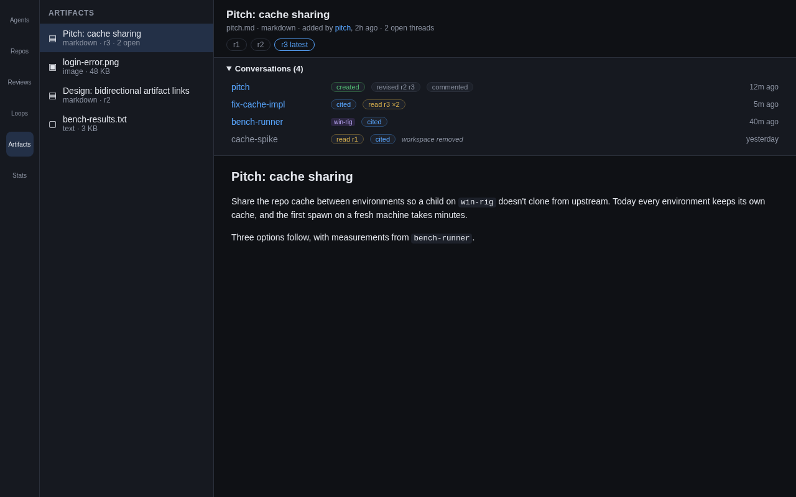
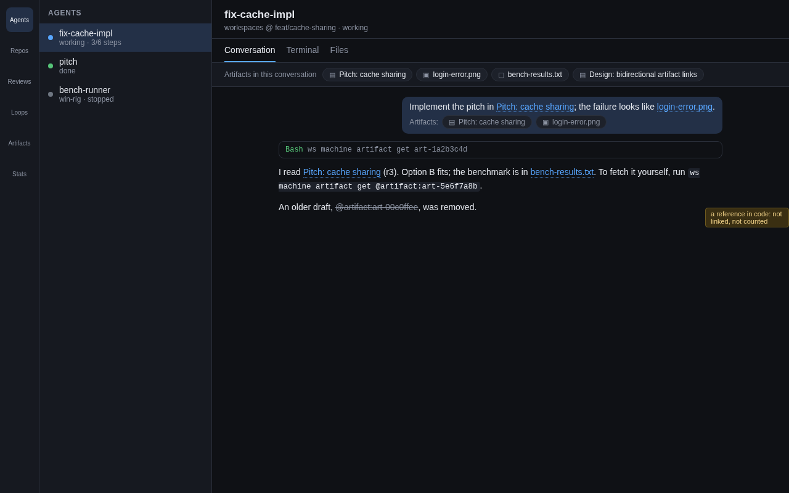
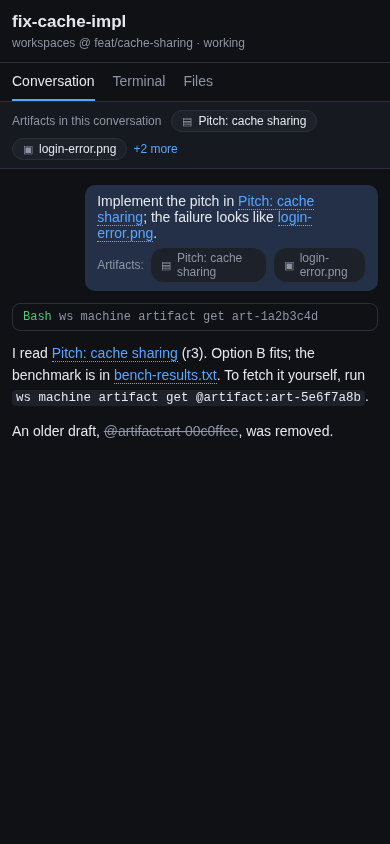

# Design: bidirectional artifact links

Decision: [0084](../../adrs/0084-bidirectional-artifact-links.md), building on
[0078](../../adrs/0078-artifacts.md) and [0079](../../adrs/0079-artifact-comments-and-anchors.md).
Build plan: [tasks.md](tasks.md); what a task can break and what the pod
can run: [constraints.md](constraints.md). Reviewed as `@artifact:art-8b2093c6`
(r1 asked six questions; r2 took the defaults except Q3 and Q4, which are in
scope here).

## What a "conversation" is

Every workspace has exactly one session and lives exactly as long as it (`ws llm`, "Sessions and lifetime"). The desktop shows that session's transcript as the agent's conversation: a Claude agent's from Claude Code's `projects/<dir>/<session>.jsonl` through `jobs/<session>/state.json`, a `ws` runner's from `state/<id>/runner/transcript.jsonl` (`desktop/src-tauri/src/commands.rs` `read_transcript`). So **a conversation is identified by its workspace id**. That is also what `Actor.workspace` already records for every agent revision and comment. No Claude session id is stored: the desktop already maps a workspace id to its agent entry (`Entry.workspaceId`).

A person is not a conversation. Person actions are not listed (Q5), except when a person cites an artifact *to* an agent; that counts for the agent's conversation.

## Conversation -> artifact (citing and rendering)

Citing stays what 0078 defined: `@artifact:<id>[/r<n>]` in any text. Nothing new is needed in prompts or agent replies. What changes is rendering:

- **Desktop conversation view** (`features/conversation/ConversationView.tsx`, `MarkdownText`): a remark plugin turns each `@artifact:<id>[/r<n>]` in assistant and thinking text into a link node with the URL `ws-artifact:<id>[?rev=<n>]`. User and notice text, which the view shows as plain text, gets the same pass over its text (outside code spans and fences, see [Code](#code-is-not-a-citation)). The `a` component handles that scheme by dispatching `artifactSelected(id)` (and the revision) plus `sectionChosen("artifacts")`. Every other scheme still goes to `openExternal`. react-markdown's default `urlTransform` drops unknown schemes, so the view passes one that keeps `ws-artifact:` (as `MarkdownViewer` already does with `keepUrl`).
- The link text is the artifact's title or name when the artifacts slice has it, else the raw reference. An id missing from the store renders struck through, titled "not in the store", and does not navigate.
- **Tool results** (for example the JSON from `ws machine artifact add`, whose `reference` field is the citation) are plain `<pre>` today. They get the same linkify pass over text nodes. They are linked, never scanned (see below).
- The hint line `(Artifacts art-…: run "ws machine artifact get <id>" …)` that `ws claude` appends is collapsed to a single "Artifacts: [chip] [chip]" row.
- **Comment bodies** on the artifact page use the same plugin, so artifacts can cite each other for free.

## Artifact -> conversations (what is recorded)

**Most of it is already recorded.** `artifact.json` has `created_by` and each revision's `created_by`; `comments.json` has each comment's `author` and each thread's `resolved_by`. Each of these is an `Actor` with `workspace`. The only interactions with no record today are **`get`** (an agent read it) and **citing** (a prompt or message that named it). So:

- **Derived at read time** (no new storage, nothing to migrate): `created`, `revised`, `commented`, `resolved`, read from the existing records.
- **Stored in a new `artifacts/<id>/links.json`** (version 1), only for `read` and `cited`:

```json
{"version": 1, "links": [
  {"workspace": "fix-login-d8efb24f", "name": "fix-login", "root": "plan-auth-1a2b3c4d",
   "environment": null, "action": "cited", "rev": null,
   "first_at": "2026-11-26T18:00:00Z", "last_at": "2026-11-26T18:00:00Z", "count": 1}]}
```

  There is one entry per (workspace, action, rev). A repeat updates `last_at` and `count` (Q1: every `get` counts, no new rows). For `cited`, `count` is the number of messages that cited it, not the number of occurrences: one message naming an artifact three times counts once. The file is written through `.tmp/` and renamed, under the artifact's lock, like `comments.json`. The cap is 500 entries: past it, the entry with the oldest `last_at` is dropped. A link write **never fails the command**: an error becomes a `warnings` entry. `get` must keep working on a full store, and the lock wait is bounded at 2 s, after which it skips the link with a warning.

**When each is written:**

| Event | Recorded as | By |
| --- | --- | --- |
| `ws machine artifact get` | `read`, with the revision copied | `ws` |
| `ws claude` / `ws machine spawn` whose prompt (or role vars) holds references, after the workspace exists | `cited`, for the new workspace, in `artifactHints`' caller; `environment` set for `ws claude --env <remote>` (Q2) | `ws` |
| A person sends a reply containing references from the desktop `ReplyBox` | `cited`, through `ws artifact cite <ref>... --workspace <id>` (desktop command `artifact_cite`), called after `sendMessage` succeeds | desktop |
| A user message (typed in the terminal) or an agent reply in a local transcript names an artifact | `cited`, through `ws artifact scan record` | desktop's transcript scan |
| `show`, `list`, `comment list` | nothing (too noisy) | |

**Output.** The full artifact JSON (`add`, `show`, `put`, both `ws artifact` and `ws machine artifact`; Q6: agents see it too) gains `conversations`, merged from both sources, one row per workspace, latest first:

```json
"conversations": [
  {"workspace": "pitch-ab12cd34", "name": "pitch", "environment": null, "removed": false,
   "actions": ["created", "revised", "commented", "cited"], "revs": [1, 2, 3],
   "first_at": "…", "last_at": "…"}]
```

`removed` is computed against `ws`'s workspace list at read time: `true` when the id is gone, and `null` for a workspace on a remote environment (not checked). The summary JSON (`list`) gains only `"conversation_count": <n>`. The added fields follow ADR 0016, which tells clients to accept fields they don't know.

## Transcript scanning

Q4 is now **yes**: the desktop scans transcripts for `@artifact:<id>[/r<n>]` in agent replies and user messages and records `cited`. The constraints that shaped it: Claude Code's transcript format is undocumented and only the desktop reads it (`transcript.rs`); a remote environment's transcripts aren't readable from here; and after `claude rm` (or `ws rm`) the transcript is gone.

### Who scans, and when

- **The desktop's Rust backend scans** (`desktop/src-tauri/src/citations.rs`, new), not `ws` and not the frontend. It already parses both transcript formats into `transcript::Item`s, so the scan reuses `items_of` and the runner mapper and can't disagree with what the conversation view shows. `ws` never learns the transcript format; it only stores what the desktop reports.
- **A background sweep** every 30 s (`citations::sweep_forever`, spawned in `lib.rs` `setup` beside `loops::tick_forever`), whether or not any conversation is open. Each sweep runs `ws list --json` once and takes the **local** workspaces whose session is a Claude agent or a `ws` runner. Remote workspaces are skipped (their transcripts aren't here; the conversation view already refuses them). Shells have no transcript.
- Workspace Online (the `online` build) has no sweep: the desktop app on the same machine does it, and two scanners would be safe anyway (dedupe below) but wasteful.
- Citations made after the last sweep and before the workspace is removed (at most about 30 s) are lost. Said once in the ADR.

### What counts as a citation

- **Scanned**: `user` and `assistant` items (`Item::User`, `Item::Assistant`). One transcript line is one **message**; its key is the line's `uuid` for Claude Code (the item id up to the first `:`), and `r<offset>` for a runner line (runner transcripts are append-only, so the offset is stable).
- **Not scanned**: thinking (private reasoning, not something the agent told anyone), tool calls and tool results (their `@artifact:` text is the output of `add`/`get`, already recorded as `created`/`read`), notices, warnings, sidechain and meta lines (`items_of` already drops them).
- **A user message carrying the hint line** (`run "ws machine artifact get <id>"`) is skipped: whoever appended the hint (`ws claude`, `ws machine spawn`, the `ReplyBox`) recorded `cited` when it sent it. Text typed into the terminal has no hint, so the scan records it. This is what keeps a prompt from counting twice.
- **References in code are not citations**, see [Code](#code-is-not-a-citation).
- An id that isn't in the store (deleted, or a typo) is skipped with no warning; the transcript is history, not input.

### Code is not a citation

Before matching, the scanner blanks out, in this order: fenced code blocks (a line opening with three or more `` ` `` or `~`, up to a closing fence of the same character and at least the same length, or the end of the message) and inline code spans (a run of N backticks up to the next run of exactly N). The desktop's remark plugin skips `code` and `inlineCode` nodes, so a reference that renders as a link is a reference the scan counts, and the reverse. Known gap, accepted: an **indented** code block (four spaces) is counted by the scan and linked by user-text rendering, though remark renders it as code in assistant text. The matcher is the same regex as `internal/artifact` (`@artifact:(art-[0-9a-f]{8})(?:/r([1-9]\d{0,2}))?`), with no word boundary, as 0078 defined.

### Storage and dedupe

Scanned citations go through `ws`, into the same `links.json` entries as every other `cited`, so **they survive the transcript**: `claude rm` deletes the transcript and the workspace, and the links stay (they are history; see [Workspace or session removed](#workspace-or-session-removed)).

The scan state is `ws`'s, per workspace, in **`state/<id>/citations.json`** (version 1), written only by `ws artifact scan record` under `state/<id>/citations.lock`:

```json
{"version": 1, "transcript": "/home/me/.claude/projects/-…/9b1c….jsonl", "offset": 482133,
 "seen": ["7f0e…:art-1a2b3c4d", "r9120:art-5e6f7a8b"], "updated_at": "2026-11-26T18:00:00Z"}
```

- **`seen`** is the exactly-once rule: one string per (message key, artifact id) already recorded. `scan record` skips a pair that is in `seen`, records the rest (each artifact under its own lock, 2 s bound), and adds only the pairs whose link write succeeded. So a rescan of the same bytes (desktop restart, a reset, two scanners, a retry after a failed write) never counts a message twice. `seen` keeps the newest 4096 pairs; a rescan that reaches a message whose pair was evicted would count it again, which needs a transcript with over 4096 citing messages to be rewritten. Accepted, and said in the ADR.
- **`transcript` and `offset`** are the cursor, only to make scanning cheap. They are advisory: a stale or lost cursor costs a rescan, never a double count. `scan record` keeps the larger offset when the transcript path is the same, and replaces both when it differs.
- `state/<id>/` is removed with the workspace, and the transcript with it, so the scan state needs no sweeping. `scan record` writes only when `state/<id>/workspace.toml` exists (checked under the lock), so a removal in progress isn't undone; otherwise it reports `workspace_not_found` for that workspace and the desktop drops it.

### Incremental and cheap

- On start the sweep reads every cursor with one `ws artifact scan cursors`, and then keeps its own cursors in memory.
- Each sweep, per workspace: `stat` the transcript. If its length equals the cursor, nothing else happens (the common case is one `stat` per agent per 30 s).
- Otherwise it reads from the cursor up to the last complete line, at most **4 MiB** per workspace per sweep (the rest waits for the next sweep), using `transcript::read_lines`' rules: a half-written last line is left for next time, so a **partial transcript** is never mis-parsed.
- Only lines whose bytes contain `@artifact:` are parsed as JSON; the rest are skipped with a byte search, so a large transcript costs a read and a `memchr`-style scan, not a parse.
- A file shorter than the cursor (rewritten), or a transcript path that changed (resumed session), is rescanned from 0; `seen` makes that safe.
- The desktop calls `ws artifact scan record` for a workspace when the new bytes held citations, or when its in-memory cursor has moved 1 MiB past the stored one (so a restart rescans at most about 1 MiB per agent), or when the path changed. One `ws` run per such workspace per sweep; none otherwise.

### Commands (hidden, under `ws artifact`)

| Command | Input | Output |
| --- | --- | --- |
| `ws artifact cite <REF>... --workspace <id>` | references (ids or `@artifact:` refs, `/r<n>` kept) | `{"workspace": "<id>", "recorded": [{"id", "rev"}], "warnings": []}`; an unknown id is `artifact_unknown`, nothing recorded |
| `ws artifact scan cursors` | none | `{"cursors": [{"workspace", "transcript", "offset", "updated_at"}], "warnings": []}` for every local workspace with a `citations.json` |
| `ws artifact scan record -` | stdin: `{"version": 1, "workspace", "transcript", "offset", "citations": [{"key", "at", "refs": ["@artifact:…"]}]}`, at most 1000 citations and 1 MiB | `{"workspace", "offset", "recorded": <n>, "skipped": <n>, "warnings": []}` |

`scan record` validates everything (`usage` for bad JSON, a newer `version`, a key that is empty or over 128 bytes, a ref that doesn't parse, more than 1000 citations); `at` sets `first_at`/`last_at` for a new entry (clamped to now), so a backfill shows when the citation was made, not when it was scanned. Unknown ids are `skipped`, not errors.

## The strip

Q3 is now **in scope**: the conversation view shows a header strip, "Artifacts in this conversation", listing the artifacts linked to that workspace.

- **Fed by** `ws artifact list --conversation <id>` (new flag on the hidden people command, desktop `artifact_list` gains a `conversation` argument; no new Tauri command). It keeps the artifacts whose merged `conversations` include `<id>`, latest `last_at` for that workspace first, and each summary gains `"conversation": {"actions": [...], "revs": [...], "first_at", "last_at"}`, that workspace's row (absent without the flag). The existing `--workspace` (created in a workspace or its tree) is unchanged.
- **When**: on opening the view, then every 15 s while it's open, and once right after the `ReplyBox` sends a message with references. It is a separate thunk from the transcript follow (1 s), so a slow list never delays the conversation.
- **Shows**: one chip per artifact (kind icon, title or name), with its actions in the tooltip ("created r1, read r2, cited"). Up to 8 chips on one line, then "+n more" that expands the row. A click selects the artifact (and its latest linked revision). Hidden when the list is empty; on an error it shows nothing and keeps the last good list (the conversation matters more).
- **Which workspace**: the entry's `workspaceId`, for Claude agents as well as runners (`ConversationView` gains a `linkWorkspaceId` prop; today `workspaceId` is set only for runners, to pick their transcript).
- Remote agents have no conversation view, so no strip.

## Workspace or session removed

Links stay. The store outlives workspaces (0078), and a link is history. The desktop shows a removed conversation's name greyed out with "workspace removed", and no link: Claude Code deletes the job with `claude rm`, so the transcript can't be opened. `ws artifact rm` deletes `links.json` with the rest. Workspace removal never touches artifacts. The scan state in `state/<id>/` goes with the workspace.

## Remote environments

- An agent on a remote environment gets `artifact_unreachable` for every `ws machine artifact` command (0078), so it creates no links. No change there.
- `ws claude --env <remote>` with references still sends the prompt unchanged with a warning, and records `cited` with `environment: "<env>"` (Q2). The desktop links to the agent entry, whose conversation view already refuses remote transcripts, so the entry shows its terminal.
- The ReplyBox's Attach button is disabled for remote agents (0078); `artifact_cite` is not called for them. Their transcripts are not scanned.
- When the store becomes reachable from remotes (the follow-up ADR), remote `get` records `read` with its environment. The schema already has the field. Scanning remote transcripts would need the environment agent to scan; not in this ADR.

## Desktop UI

- **Artifact page**: a "Conversations (n)" section under the revision bar, collapsed by default when n > 5. Each row shows: name, environment badge, action chips (`created`, `revised r2 r3`, `commented`, `read r1`, `cited`), age, and a removed state. A click dispatches `agentFocused(entry key for workspace)` and `agentViewChosen("conversation")`.
- **Conversation view**: the links described above, and [the strip](#the-strip).
- Mockups: [below](#mockups). The app has one theme (dark, `desktop/src/theme.ts`), so there is no light variant.

## CLI and pinned lists (from `docs/design/artifacts/constraints.md`)

- **C1 error codes:** none new. A link failure is a warning; `cite` reuses `artifact_unknown` and `usage`; `scan record` reuses `usage` and `workspace_not_found`. `ADR 0016`'s status line is unchanged.
- **C2 command tree and guides:** `ws artifact cite`, `ws artifact scan cursors` and `ws artifact scan record`, and `ws artifact list --conversation`, are under the hidden people command, so they need no guide. `ws llm machine artifact get`/`show`/`add`/`put` guides gain `conversations` in `## JSON output`, and `list` gains `conversation_count`. `guides/ws.md`'s `@artifact:` rule gets one clause: "`get` records that your conversation read it, and naming it in a reply records a citation". No new topics.
- **C3 config paths:** none (`state/<id>/` already exists). **C4 runner guard:** none, since `get` is already allowed.
- **C6 docs:** `docs/tools/ws-artifact.md` (`cite`, `scan`, `list --conversation`, `conversations`), `docs/tools/ws-machine.md` (JSON), `docs/state.md` (rows for `artifacts/<id>/links.json` and `state/<id>/citations.json` with its `.lock`), and the `README.md` roadmap line.
- **C7 Tauri/web command table:** append `artifacts::artifact_cite` to `generate_handler!` and to `online/dispatch.rs` `COMMANDS` in the same order, add a `match` arm, and add the wrapper in `api.ts`. `artifact_list` gains an optional `conversation` argument (its `match` arm reads it); `artifact_show` returns `conversations` with no new command. The scan has no Tauri command (it's a backend task). Add `artifact_cite`, `conversation` handling in `artifact_list` and sample `conversations` to `desktop/test/tauri-mock.js`.
- **C8 sections:** none.

## Migration

None needed. Existing artifacts get `created`, `revised`, `commented` and `resolved` from their records the first time they're shown. `read` starts empty, because earlier reads left no trace. `cited` is backfilled for local agents whose transcripts still exist: the first sweep scans each from 0 (in 4 MiB steps), with each citation's own time. That is said once in the ADR. `links.json` and `citations.json` are absent until first written, as `comments.json` is. A `links.json` with a newer `version` is ignored with a warning rather than `artifact_invalid`, since it's never needed to read the artifact; a `citations.json` with a newer version makes `scan record` refuse that workspace (`usage`), so an older `ws` never rewrites it.

## Tests

- **`internal/artifact`:** table tests for merging derived and stored links (dedupe, ordering, actions, revs); the cap and eviction; and dropping a link when the lock times out. Concurrent `get` calls each recording under the lock, and a reader seeing the old or new `links.json`. `RecordCitations`: a pair in `seen` is skipped; a pair whose link write failed isn't added to `seen`; `seen` eviction at 4096; the cursor keeps the larger offset and is replaced on a new path; `at` clamped to now.
- **`internal/cli`:** `get` records `read` and the output carries `conversations`. `machine spawn` and `claude` record `cited` for the created id. A link write failure (read-only `links.json`) still prints the path, plus a warning. `cite` rejects an unknown id. `scan record` twice with the same input records once; refuses bad input with `usage`; skips unknown ids; refuses a removed workspace. `scan cursors` lists the cursors. `list --conversation` filters and adds `conversation`. `removed` is true after the workspace record is deleted. `TestGuideTopics` stays green.
- **Desktop Rust:** `citations.rs`: refs in fences and inline code are not found, `/r<n>` kept, hinted user messages skipped, thinking and tools skipped, one message counts once, a half-written last line waits, the 4 MiB step, a shorter file rescans from 0, the 1 MiB persist rule. `dispatch.rs`'s `commands_match_generate_handler` and `every_command_is_handled`.
- **Desktop (Vitest):** the remark plugin, covering refs inside code spans (not linked), `/r<n>`, and unknown ids. Clicking a `ws-artifact:` link selects the artifact and revision and never calls `openExternal`. The Conversations section's rows, the removed state, and the click selecting the agent. The strip: chips, "+n more", hidden when empty, last good list kept on error. ReplyBox calls `artifact_cite` only when the text has references and the agent is local. **Playwright screenshot** of both views with the mock, at desktop and phone width.

## Stacked PRs

1. **docs:** ADR 0084 (accepted in its PR), this folder with mockups, constraints and tasks. Update the ADR index.
2. **CLI/backend (Go):** `links.json` in `internal/artifact`, the merge, `get` and `cited` recording, `ws artifact cite`, `ws artifact scan`, `list --conversation`, the JSON fields, guides and docs (C2, C6).
3. **desktop (TS + Rust):** `artifact_cite` (C7), the transcript sweep, the remark linkifier in the conversation view, tool results and comments, the strip, and the Conversations section. Mock data and screenshots.

## Mockups

[`mockups.html`](mockups.html) draws the screens with the app's colors and
type; open it with a hash (`mockups.html#artifact-page`). The PNGs in
[`img/`](img/) are rendered from it:

```console
$ H=$(find ~/.cache/ms-playwright -name chrome-headless-shell -type f | head -1)
$ for s in artifact-page conversation-strip; do
    "$H" --hide-scrollbars --window-size=1280,800 --screenshot="$PWD/img/$s.png" "file://$PWD/mockups.html#$s"
  done
$ "$H" --hide-scrollbars --window-size=390,844 --screenshot="$PWD/img/conversation-strip-phone.png" "file://$PWD/mockups.html#conversation-strip"
```

The artifact page with its Conversations section:



The conversation view with the strip, linked references, a reference in
code (not linked) and the collapsed hint row:



At phone width the strip wraps to "+n more":



## Answered questions

1. Record `read` on every `get`? **Every get updates one entry (`count`, `last_at`); no new rows.** (default kept)
2. Record `cited` for `ws claude --env <remote>`? **Yes, with `environment`.** (default kept)
3. The "Artifacts in this conversation" strip? **In scope** (changed): fed by `ws artifact list --conversation <id>`.
4. Scan transcripts for citations? **Yes** (changed): the desktop scans local transcripts every 30 s and records through `ws artifact scan record`, deduped per (message, artifact) in `state/<id>/citations.json`.
5. Show person actions in the list? **No.** (default kept)
6. `machine artifact show` prints `conversations` to agents? **Yes.** (default kept)
