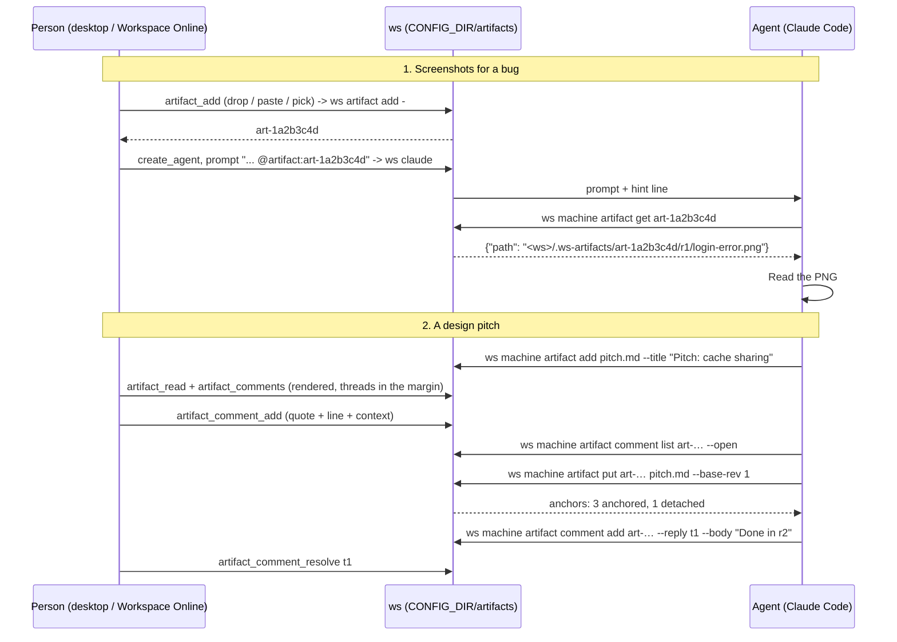

# Design: artifacts

Decisions: [0078](../../adrs/0078-artifacts.md) (store, commands, limits,
rendering, references, remote environments) and
[0079](../../adrs/0079-artifact-comments-and-anchors.md) (comments and
anchors). Build plan: [tasks.md](tasks.md); what a task can break and what
the pod can't run: [constraints.md](constraints.md).

## The two flows



## Ids and references

- An artifact id is `art-` and 8 lowercase hex digits: `art-1a2b3c4d`.
- A reference is `@artifact:<id>` (latest revision) or `@artifact:<id>/r<n>`.
  Regex: `@artifact:(art-[0-9a-f]{8})(?:/r([1-9][0-9]{0,2}))?`.
- Every command that takes an `<ID>` also takes a reference; a reference
  with `/r<n>` and a `--rev` that differs is `usage`.
- The hint line `ws claude`, `ws machine spawn` and the desktop's reply box
  append when a prompt has references (ids in first-seen order, no
  duplicates, separated by `, `), after one blank line:

  ```
  (Artifacts art-1a2b3c4d, art-5e6f7a8b: run "ws machine artifact get <id>" for each, then read the file at the "path" it prints.)
  ```

  It is appended once; a prompt that already contains the exact text
  `run "ws machine artifact get <id>"` gets nothing appended.

## Kinds, types and limits

| Kind | `content_type` | Detected by | Max size | Preview |
| --- | --- | --- | --- | --- |
| `image` | `image/png`, `image/jpeg`, `image/gif`, `image/webp` | `http.DetectContentType(first 512 bytes)` | 10 MiB | `` |
| `image` | `image/svg+xml` | name ends `.svg` (any case), valid UTF-8, first element after an optional `<?xml …?>`, comments, whitespace and `<!DOCTYPE …>` is `<svg` | 1 MiB | `` only |
| `markdown` | `text/markdown; charset=utf-8` | name ends `.md` or `.markdown` (any case), valid UTF-8, no NUL byte | 1 MiB | `react-markdown` + `remark-gfm`, `skipHtml` |
| `text` | `text/plain; charset=utf-8` | any other valid UTF-8 with no NUL byte | 1 MiB | `<pre>` |

Refused with `artifact_invalid`: empty files, anything else (binary that
isn't one of the four images, PDF, archives, non-UTF-8 text), a size over
the kind's limit, and a revision whose kind differs from the artifact's.

| Limit | Value | Error |
| --- | --- | --- |
| Name | 1-128 characters (runes), one path element, no `/`, `\`, control characters, leading `.` | `artifact_invalid` |
| Title, revision note | up to 200 characters, one line; empty means none | `artifact_invalid` |
| Revisions an artifact | 100 | `artifact_full` |
| Store | 2 GiB, the sum of every revision's `size` in every record | `artifact_full` |
| Threads an artifact | 200 | `artifact_full` |
| Comments a thread | 50 | `artifact_full` |
| Comment body | 1-10,000 characters, not only whitespace | `artifact_invalid` |
| Anchor quote | 1-2,000 characters, not only whitespace | `artifact_invalid` |
| `list --limit` | 1-1,000, default 100 | `usage` |

## On disk

Under `CONFIG_DIR` ([0078](../../adrs/0078-artifacts.md)); private to
`ws`, the JSON output below is the contract.

```
artifacts/                    0700
  .tmp/                       temp files; a write deletes leftovers older than 1 h
  art-1a2b3c4d/               0700
    .lock                     flock, exclusive for every write; readers take none
    artifact.json             0600, the record
    r1  r2 …                  0600, each revision's bytes; never rewritten
    comments.json             0600, threads; absent until the first comment
```

`artifact.json`, version 1:

```json
{"version": 1, "id": "art-1a2b3c4d", "name": "pitch.md", "title": "Pitch: cache sharing",
 "kind": "markdown", "content_type": "text/markdown; charset=utf-8",
 "created_at": "2026-11-23T18:00:00Z",
 "created_by": {"kind": "agent", "workspace": "pitch-ab12cd34", "name": "pitch"},
 "root": "plan-1a2b3c4d",
 "revisions": [
   {"rev": 1, "size": 2048, "sha256": "9f86d0…", "created_at": "2026-11-23T18:00:00Z",
    "created_by": {"kind": "agent", "workspace": "pitch-ab12cd34", "name": "pitch"}, "note": null}]}
```

`root` is the root of the creating agent's workspace tree, or `null` for a
person; `ws machine artifact rm` and `list --mine` compare it with the
caller's root.

`comments.json`, version 1: `{"version": 1, "threads": [<thread>…]}`, each
thread exactly as printed below. Threads and comments are never deleted, so
a new thread's id is `t<len(threads)+1>` and a new comment's
`c<len(comments)+1>`.

**Write order** (all under `<id>/.lock`): bytes to `.tmp/<random>`,
`fsync`, rename to `<id>/r<n>`; then `artifact.json` (and, for `put`,
`comments.json` with moved anchors) to `.tmp/`, rename into place. Creating
an artifact makes `<id>/` with `os.Mkdir` (a collision draws a new id, up
to 5 tries). `rm` renames `<id>/` to `.tmp/rm-<id>-<random>` under the lock,
then deletes it, so a reader sees the whole artifact or none.

A record or comments file with `version` above 1 is refused with
`artifact_invalid` naming the file; such an artifact is listed with a
warning and never written.

## JSON shapes

All output follows [ADR 0016](../../adrs/0016-output-contract.md):
`snake_case`, RFC 3339 UTC times, `null` for no value, `[]` for empty
lists, a `warnings` array on every top-level object.

**Actor** (`created_by`, `author`, `resolved_by`):

```json
{"kind": "person", "workspace": null, "name": null}
{"kind": "agent", "workspace": "pitch-ab12cd34", "name": "pitch"}
```

**Artifact summary** (`list`, and `artifact` in `get`):

```json
{"id": "art-1a2b3c4d", "reference": "@artifact:art-1a2b3c4d", "name": "pitch.md",
 "title": "Pitch: cache sharing", "kind": "markdown", "content_type": "text/markdown; charset=utf-8",
 "latest": 2, "size": 2311, "created_at": "2026-11-23T18:00:00Z", "updated_at": "2026-11-23T19:10:00Z",
 "created_by": {"kind": "agent", "workspace": "pitch-ab12cd34", "name": "pitch"},
 "threads": {"open": 2, "resolved": 1, "detached": 1}}
```

`size` is the latest revision's; `updated_at` the latest revision's
`created_at`; `threads.open` counts unresolved threads, `detached` those
whose anchor `state` is `detached` (open or not).

**Artifact** (`add`, `show`, `put`): the summary plus `"revisions":
[{"rev", "size", "sha256", "created_at", "created_by", "note"}]`, oldest
first.

**Thread**:

```json
{"id": "t1",
 "anchor": {"rev": 2, "start": 120, "end": 139, "line_start": 7, "line_end": 7,
            "quote": "the cache is shared", "prefix": "Today ", "suffix": " across workspaces.",
            "state": "anchored"},
 "resolved": false, "resolved_at": null, "resolved_by": null,
 "comments": [
   {"id": "c1", "author": {"kind": "person", "workspace": null, "name": null},
    "body": "Shared how? Per repo or per user?", "created_at": "2026-11-23T18:20:00Z"}]}
```

`anchor` is `null` for a thread about the whole artifact. `start`/`end`
are UTF-8 byte offsets into revision `rev`; `state` is `anchored` when
`rev` is the latest revision, else `detached`.

## `ws machine artifact` (agents)

Visible, with a `ws llm` guide for each command. Always JSON. Run inside
your workspace (`outside_workspace` otherwise). On an enrolled remote
environment's agent machine every subcommand fails with
`artifact_unreachable`.

```
ws machine artifact add <PATH|-> [--name <name>] [--title <text>] [--note <text>]
ws machine artifact list [--kind image|markdown|text] [--mine] [--limit <n>]
ws machine artifact show <ID>
ws machine artifact get <ID> [--rev <n>] [--out <dir>]
ws machine artifact put <ID> <PATH|-> [--base-rev <n>] [--note <text>]
ws machine artifact rm <ID>...
ws machine artifact comment list <ID> [--open]
ws machine artifact comment add <ID> (--body <text> | --body-file <path|->) [--reply <thread> | --quote <text> [--line <n>]]
ws machine artifact comment resolve <ID> <THREAD> [--reopen]
```

| Command | Does | Prints |
| --- | --- | --- |
| `add` | stores the file as a new artifact; `-` reads stdin and needs `--name`; `--name` defaults to the file's base name | `{"artifact": <artifact>, "warnings": []}` |
| `list` | artifacts, latest `updated_at` first; `--mine` only those whose `root` is the caller's tree's root | `{"artifacts": [<summary>…], "warnings": []}` |
| `show` | one artifact with its revisions | `{"artifact": <artifact>, "warnings": []}` |
| `get` | copies revision `--rev` (default latest) to `<dir>/<name>`; `<dir>` is `--out`, else `<workspace>/.ws-artifacts/<id>/r<n>`; created 0700, file 0600, overwritten if it exists | `{"artifact": <summary>, "rev": 1, "path": "/abs/…/login-error.png", "content_type": "image/png", "size": 48213, "warnings": []}` |
| `put` | appends a revision (same kind), moves anchors (ADR 0079) | `{"artifact": <artifact>, "anchors": {"anchored": 3, "detached": 1}, "warnings": []}` |
| `rm` | removes artifacts the caller's tree created | `{"artifacts": [{"id": "art-…", "removed": true, "error": null}], "warnings": []}`; exit code of the first failure |
| `comment list` | threads in creation order; `--open` drops resolved ones | `{"artifact_id": "art-…", "latest": 2, "threads": [<thread>…], "warnings": []}` |
| `comment add` | a new thread (anchored with `--quote`, else whole-artifact), or with `--reply` a comment on thread `t<n>` | `{"artifact_id": "art-…", "thread": <thread>, "comment": <comment>, "warnings": []}` |
| `comment resolve` | marks the thread resolved, or with `--reopen` open | `{"artifact_id": "art-…", "thread": <thread>, "warnings": []}` |

`--quote` with `--reply` is `usage`; `--line` without `--quote` is
`usage`; `--body` and `--body-file` together, or neither, is `usage`.
`comment add --quote` on an `image` is `artifact_invalid`.

### Error codes and exit codes

New codes (`internal/cli/errors.go`), in the overview's exit-code table:

| Code | Exit | When |
| --- | --- | --- |
| `artifact_invalid` | 2 | a type that isn't allowed, a size over the limit, an empty file, a kind change on `put`, a bad name, title, note, body or quote, an anchored comment on an image, a record from a newer `ws` |
| `artifact_unknown` | 3 | no artifact, revision or thread with that id; an `@artifact:` reference in a `ws claude` / `ws machine spawn` prompt that doesn't exist |
| `anchor_not_found` | 3 | the quote isn't in the latest revision, or occurs more than once and `--line` / context doesn't pick one; `details: {"occurrences": <n>, "lines": [<n>…]}` |
| `artifact_conflict` | 4 | `put --base-rev <n>` and the latest revision isn't `n`; `details: {"latest": <n>}` |
| `artifact_full` | 4 | a revision, thread, comment or store limit |
| `artifact_forbidden` | 4 | `ws machine artifact rm` of an artifact another tree (or a person) created |
| `artifact_unreachable` | 1 | any `ws machine artifact` command on an enrolled environment agent's machine |

Existing codes also used: `usage` (2), `outside_workspace` (2).

### Guides

One guide per visible command, `internal/cli/guides/ws-machine-artifact*.md`:
`machine artifact`, `machine artifact add`, `list`, `show`, `get`, `put`,
`rm`, `machine artifact comment`, `comment list`, `comment add`,
`comment resolve` (11 files). `ws-machine-artifact.md` holds the
lifecycle:

> People upload screenshots and logs, and read what you upload, rendered,
> in the desktop app. When a prompt says `@artifact:art-1a2b3c4d`, run
> `ws machine artifact get art-1a2b3c4d` and read the file at the printed
> `path` with your Read tool; if the read is refused, rerun with
> `--out <a directory inside your working directory>`. To show a person a
> document (a design pitch, a report), `ws machine artifact add pitch.md
> --title "…"` and give them the `reference`. When they say they've
> commented, `ws machine artifact comment list <id> --open`, change the
> file, `ws machine artifact put <id> pitch.md --base-rev <latest>`, then
> reply to each thread you addressed with `comment add --reply t<n>` and
> resolve it.

`ws.md` (the overview) gains, under "Rules for agents":

> - `@artifact:<id>` in a prompt names a file a person shared: run
>   `ws machine artifact get <id>` and read the `path` it prints.

and the eleven `ws llm machine artifact…` lines in its command list, after
`machine progress show`.

## `ws artifact` (people and the desktop app, hidden)

`Hidden: true`, `GroupID: peopleGroup`; no guide, not in `ws llm`;
documented in `docs/tools/ws-artifact.md`. `--json` as for every people
command; without it, a short table or message. The author is always the
person.

```
ws artifact add <PATH|-> [--name <name>] [--title <text>] [--note <text>]
ws artifact list [--kind image|markdown|text] [--workspace <id>] [--limit <n>]
ws artifact show <ID>
ws artifact cat <ID> [--rev <n>]
ws artifact rm <ID>...
ws artifact comment list <ID> [--open]
ws artifact comment add <ID> (--body <text> | --body-file <path|->) [--reply <thread> | --quote <text> [--line <n>] [--prefix <text>] [--suffix <text>]]
ws artifact comment resolve <ID> <THREAD> [--reopen]
```

- Same JSON as the machine commands. `list --workspace <id>` keeps those
  whose `created_by.workspace` or `root` is `<id>`.
- `cat` writes the revision's raw bytes to stdout, even with `--json`;
  errors are still JSON on stderr with `--json`.
- `rm` removes any artifact.
- `--prefix` and `--suffix` are the context the desktop sends with a
  rendered selection (ADR 0079); agents don't need them.
- People don't `put`: revising is the agent's job. `ws artifact` has no
  `get` (use `cat > file`).
- Not refused on a remote agent machine (a person there sees their own
  store), but that store isn't the controller's.

## Desktop and Workspace Online commands

`desktop/src-tauri/src/artifacts.rs`, each `#[cfg_attr(feature = "desktop",
tauri::command)]`, each running `ws artifact … --json` through
`Runner`. Arguments are camelCase; results are serialised camelCase.
Workspace Online dispatches the same functions (`online/dispatch.rs`),
and `/api/invoke/{command}` accepts bodies up to 16 MiB.

| Command | Arguments | Runs | Returns |
| --- | --- | --- | --- |
| `artifact_list` | `{kind: string \| null, workspace: string \| null}` | `ws artifact list --json [--kind k] [--workspace w] --limit 1000` | `ArtifactSummary[]` |
| `artifact_show` | `{id}` | `ws artifact show --json <id>` | `Artifact` |
| `artifact_read` | `{id, rev: number \| null}` | `ws artifact cat <id> [--rev n]` (stdout bytes) and `show` for the type | `{rev, contentType, size, dataBase64}` |
| `artifact_add` | `{name, title: string \| null, dataBase64}` | decodes; over 10 MiB is `AppError("artifact_invalid")` without running `ws`; `ws artifact add - --json --name <name> [--title t]` with the bytes on stdin | `Artifact` |
| `artifact_remove` | `{id}` | `ws artifact rm --json <id>` | `null` |
| `artifact_comments` | `{id}` | `ws artifact comment list --json <id>` | `CommentList` |
| `artifact_comment_add` | `{id, body, reply: string \| null, anchor: {quote, line, prefix, suffix} \| null}` | `ws artifact comment add --json <id> --body-file -` (body on stdin) plus `--reply`, or `--quote --line --prefix --suffix` | `{thread, comment}` |
| `artifact_comment_resolve` | `{id, thread, reopen: boolean}` | `ws artifact comment resolve --json <id> <thread> [--reopen]` | `Thread` |

TypeScript (`desktop/src/api.ts`):

```ts
export type ArtifactKind = "image" | "markdown" | "text";
export interface Actor { readonly kind: "person" | "agent"; readonly workspace: string | null; readonly name: string | null }
export interface ThreadCounts { readonly open: number; readonly resolved: number; readonly detached: number }
export interface ArtifactSummary {
  readonly id: string; readonly reference: string; readonly name: string; readonly title: string | null;
  readonly kind: ArtifactKind; readonly contentType: string; readonly latest: number; readonly size: number;
  readonly createdAt: string; readonly updatedAt: string; readonly createdBy: Actor; readonly threads: ThreadCounts;
}
export interface Revision { readonly rev: number; readonly size: number; readonly sha256: string; readonly createdAt: string; readonly createdBy: Actor; readonly note: string | null }
export interface Artifact extends ArtifactSummary { readonly revisions: readonly Revision[] }
export interface ArtifactContent { readonly rev: number; readonly contentType: string; readonly size: number; readonly dataBase64: string }
export interface Anchor {
  readonly rev: number; readonly start: number; readonly end: number; readonly lineStart: number; readonly lineEnd: number;
  readonly quote: string; readonly prefix: string; readonly suffix: string; readonly state: "anchored" | "detached";
}
export interface ThreadComment { readonly id: string; readonly author: Actor; readonly body: string; readonly createdAt: string }
export interface Thread {
  readonly id: string; readonly anchor: Anchor | null; readonly resolved: boolean;
  readonly resolvedAt: string | null; readonly resolvedBy: Actor | null; readonly comments: readonly ThreadComment[];
}
export interface CommentList { readonly artifactId: string; readonly latest: number; readonly threads: readonly Thread[] }
export interface NewAnchor { readonly quote: string; readonly line: number; readonly prefix: string; readonly suffix: string }
```

## Desktop UI

A new rail section, **Artifacts**, between Loops and Stats (`Section`
gains `"artifacts"`). Its list is the artifacts, its pane the viewer.
Uploads also happen where prompts are written.

### Artifacts list and upload

```
┌ Artifacts ─────────────────────────── [ Upload ] ┐
│ [All] [Images] [Documents] [Text]   [ search… ] │
│ ┌────────────────────────────────────────────┐   │
│ │  Drop files here, or paste an image        │   │  <- drop zone, dashed, shown while dragging
│ └────────────────────────────────────────────┘   │
│ ▣ login-error.png        image · 48 KB  2m ago   │
│   you                                            │
│ ▤ Pitch: cache sharing   r2 · 2 open · 1 det.    │  <- title if set, else name
│   pitch-ab12cd34                                 │
│ ▤ build.log              text · 12 KB  1h ago    │
│   fix-ci-77aa01bc                                │
└──────────────────────────────────────────────────┘
```

- **Upload** opens the file picker (`<input type="file" multiple>`,
  `accept` the allowed extensions and `image/*`); dropping files on the
  list, or pasting an image anywhere in the section, uploads them. Each
  upload shows a row with a spinner, then the new artifact, selected.
  Files over 10 MiB are refused in the browser with the limit in the
  message, before any upload; `ws`'s own errors show as a snackbar.
- Chips filter by kind (Documents = `markdown`); search matches name and
  title. Rows show kind, size, revision when above 1, open and detached
  thread counts, the creator (`you` or the workspace id), and relative
  time. Phone width: one column, chips scroll horizontally inside their
  row, 40px tap targets.

### Image viewer

```
┌ login-error.png ───────────────────────────────────────────────┐
│ [ Copy reference ] [ Fit | 100% ] [ r1 ▾ ]           [ Delete ] │
│ ┌────────────────────────────────────────────────────────────┐ │
│ │                                                            │ │
│ │                   (the image, fitted)                      │ │
│ │                                                            │ │
│ └────────────────────────────────────────────────────────────┘ │
│ image/png · 48 KB · 1280×800 · added by you, 2m ago           │
│ Comments (1)                                                    │
│   you: The red banner only shows on Safari.        [ Resolve ] │
│ [ Add a comment…                                    ] [ Post ] │
└────────────────────────────────────────────────────────────────┘
```

- `;base64,…" alt="<name>">`; SVG the same
  way, never inlined. Fit scales down to the pane; 100% scrolls inside
  the frame (no page scroll).
- **Copy reference** copies `@artifact:<id>` (with `/r<n>` when an older
  revision is shown). Delete asks to confirm.
- Comments on an image are whole-artifact threads.

### Markdown viewer with comment threads

```
┌ Pitch: cache sharing  (pitch.md) ────────────────────────────────────────┐
│ [ Copy reference ] [ r2 ▾ ]  2 open · 1 resolved · 1 detached [ Delete ] │
├───────────────────────────────────────────────┬──────────────────────────┤
│ # Pitch: cache sharing                         │ ┌ t1 ───────────────────┐│
│                                                │ │ "the cache is shared" ││
│ Today ▓the cache is shared▓ across workspaces.─┼─│ you: Shared how?      ││
│ Each clone reads from it…                      │ │ pitch: Per user; see  ││
│                                                │ │ §2. Done in r2.       ││
│ ## Design                                      │ │ [Reply…] [Resolve]    ││
│ ▓We keep one lock per repo▓ and…  ─────────────┼─│ t3 (1 comment)        ││
│                                                │ └───────────────────────┘│
│                                                │ Detached (1)             │
│     ┌──────────────────┐                       │  t2 on r1: "the old      │
│     │ [ Comment ]      │  <- shown on select   │  wording" — you: …      │
│     └──────────────────┘                       │ Resolved (1) ▸           │
│                                                │ [ Comment on the whole ] │
└───────────────────────────────────────────────┴──────────────────────────┘
```

- Rendered with `react-markdown` + `remark-gfm`, `skipHtml`, a `urlTransform`
  that keeps only `http:`, `https:`, `mailto:` and `#` links, links opened
  with `api.openExternal`, and an `img` component that renders
  `[image: <alt>](<url>)` as text instead of loading it.
- Every block element (`p`, `h1`-`h6`, `li`, `blockquote`, `pre`, `table`
  rows) carries `data-line-start` and `data-line-end` from
  `node.position`.
- **Selecting** text inside one block shows a floating **Comment** button.
  It opens a composer showing the quote it will anchor; Post sends
  `{quote, line, prefix, suffix}` from `selectionAnchor(source, block,
  selectedText)` (see tasks.md T6). When the selected text isn't in the
  block's source as-is, the composer says "Comments on the whole
  paragraph" and anchors the block.
- **Highlights**: for each anchored thread on the shown revision, the
  viewer finds `quote` inside the block whose lines contain `line_start`
  and wraps it in `<mark data-thread="t1">`; when the quote spans blocks
  or isn't found in the rendered text, the block gets a left border
  instead. Clicking a mark scrolls its thread into view and vice versa.
- The margin column lists anchored open threads in document order, then
  **Detached** (quote and its revision), then **Resolved** collapsed.
  Under 900px the margin moves below the document; under 720px threads
  open in a bottom sheet.
- Older revisions (`r1 ▾`) are read-only and show no highlights or
  composer.

### Text viewer

The same frame as the image viewer, with the text in a `<pre>` that wraps
long lines, and whole-artifact comments.

### Referencing artifacts in a prompt

```
New agent
  Repos   [ buff-bear@main                              ]
  Prompt  ┌──────────────────────────────────────────────┐
          │ The login page breaks on Safari, see          │
          │ @artifact:art-1a2b3c4d and fix it.            │
          └──────────────────────────────────────────────┘
          [ Attach ]  ▣ login-error.png ✕               <- chips of referenced artifacts
```

- **Attach** opens the file picker; dropping files on the prompt field or
  pasting an image into it uploads each (`artifact_add`) and inserts
  `@artifact:<id>` at the cursor, with a space after. A chip per reference
  shows the name; ✕ removes the reference text. While an upload runs the
  Create button is disabled.
- Typing `@artifact:` opens a picker of recent artifacts (name, kind)
  that inserts the reference; it closes on Escape.
- The prompt goes to `create_agent` as typed; `ws claude` appends the hint
  line.
- The terminal's **reply box** (`ReplyBox`) has the same Attach button,
  drop and paste; on send, when the message contains references, it
  appends the hint line (see "Ids and references") before sending.
- On an agent whose workspace is on a remote environment, Attach is
  disabled with the tooltip "Artifacts aren't reachable from <env> yet."

## Not in this design

- Reaching the store from a remote environment (an `artifact.*` request on
  the agent's `up` topic); until then `artifact_unreachable`.
- PDF and other binary types; region comments on images; fuzzy
  re-anchoring; notifying an agent when a person comments; editing an
  artifact's content in the desktop app; expiry. Each is listed in the ADRs
  with why.
