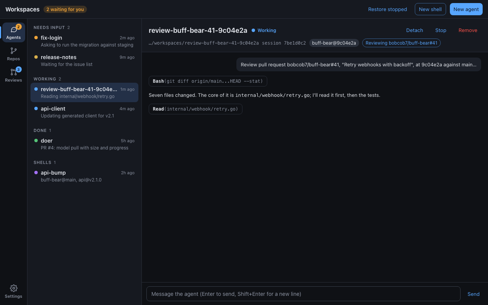

# Desktop app sections: design

How the desktop app ([ADR 0029](../../adrs/0029-desktop-app.md)) grows from
one screen of agents into sections: **Agents**, **Repos**, **Reviews**, and
**Settings**. This doc covers the frame they share; each section has its
own doc:

| Section  | Doc                        | Built in                     |
| -------- | -------------------------- | ---------------------------- |
| Agents   | unchanged, apart from the rail | the Repos or Reviews PR, whichever lands first |
| Repos    | [repos.md](repos.md)       | its own PR; decisions in [0033](../../adrs/0033-ws-cache-refs.md) |
| Reviews  | [reviews.md](reviews.md)   | its own PR                   |
| Settings | [settings.md](settings.md) | the Reviews PR adds the first group |

Decisions with lasting consequences are ADRs:
[0031](../../adrs/0031-desktop-sections-rail.md) (the rail and section
frame) and [0032](../../adrs/0032-review-agent-per-pr-head.md) (what a
review agent is and how the app finds it). The screenshots here are
mockups, not the app; see [Mockups](#mockups).

## The frame



- **Top bar** (unchanged position): the brand and "N waiting for you"
  badge on every section; on the right, the current section's actions.
- **Section rail**, 72 px, at the left: Agents, Repos, Reviews, and
  Settings at the bottom. Icon over a label; the current section has a
  raised background and an accent bar on its left edge. Agents' badge is
  the needs-input count (amber); Reviews' badge is the number of pull
  requests to review (accent blue).
- **List** (300 px) and **detail**, as in Agents today. Lists use the same
  grouped, counted, uppercase headings and two-line rows (name and age;
  summary under it). Detail panes have the same header: title, a status,
  actions on the right, a meta line of mono text and chips.

### Rules every section follows

1. **Actions live in two places**: section-wide ones in the top bar
   (Add repo, Check now), item ones in the detail header (Fetch, Review,
   Remove). Destructive actions are red and confirm in a dialog that says
   what will and won't be lost.
2. **Selection is per section** and survives switching sections.
3. **Cross-links switch section and select**: "Show in Reviews" from a
   repo, "Open agent" from a review, the "Reviewing …#41" chip on a review
   agent.
4. **Everything goes through a CLI**, as in 0029: `ws` for the cache and
   workspaces, `claude` for sessions, `gh` for pull requests. Errors keep
   the CLI's codes and show as an Alert in the pane or a Snackbar for
   actions.
5. **Long lists filter** with a search box at the top of the list (Repos,
   Reviews). Agents doesn't need one yet.
6. **Empty states teach**: say what the section is for and offer the one
   action that fills it.
7. **Keyboard**: ⌘1–⌘4 choose sections; ↑/↓ move through the list.

### State

- `uiSlice.section: "agents" | "repos" | "reviews" | "settings"`, default
  `"agents"`, plus a `sectionChosen` action. Not persisted.
- Each section has `features/<section>/` with its own slice, which holds
  its selection (`reposSlice.selectedId`, `reviewsSlice.selectedKey`).
  `ui.selectedKey` stays the selected agent.
- `App.tsx` renders `<Rail />` and switches on `section` for the top-bar
  actions, list, and detail. Each section exports `XActions`, `XList`, and
  `XPane` components so `App.tsx` only wires them in.

### Who builds what

The Repos and Reviews PRs are built in parallel from this doc. To keep
conflicts small:

- **Whichever PR lands first** adds `features/rail/Rail.tsx`,
  `uiSlice.section`, ⌘1–⌘4, and moves the Agents actions into
  `AgentsActions`. The other rebases and keeps it. Both should write the
  rail the same way (this doc and the screenshots are the spec) so the
  rebase is mechanical.
- Rail entries for sections that aren't built yet aren't shown: the Repos
  PR shows Agents and Repos; the Reviews PR shows Agents and Reviews, plus
  Settings since it adds the Reviews settings group.
- Repos owns `features/repos/`, and the Rust commands for the cache.
  Reviews owns `features/reviews/`, `features/settings/`, and the Rust
  commands for `gh` and settings storage.
- The **Pull request reviews** card in a repo's detail ([repos.md](repos.md))
  belongs to Reviews: the Repos PR leaves a slot for it
  (`<RepoReviewsCard repoId />` rendered if the Reviews feature exports
  it), and the Reviews PR fills it. The Repos PR built this as named
  exports from any module in `features/reviews/`; see
  [Slots for Reviews](repos.md#slots-for-reviews).

## Mockups

[`mockups.html`](mockups.html) draws every screen with the app's colors and
type; open it with a hash (`mockups.html#repos`) to pick one. The PNGs in
[`img/`](img/) are rendered from it at 1280 × 800:

```console
$ H=$(find ~/Library/Caches/ms-playwright -name chrome-headless-shell -type f | head -1)
$ for s in agents repos repos-add repos-remove reviews reviews-start reviews-reviewed reviews-watched reviews-empty settings; do
    "$H" --hide-scrollbars --window-size=1280,800 --screenshot="$PWD/img/$s.png" "file://$PWD/mockups.html#$s"
  done
```

Any Chromium works; `chrome-headless-shell` is used because full Chrome's
`--headless=new` crops the viewport. Once a section ships, its real
screenshots go in `desktop/docs/` as today, and the mockups stay as the
record of the design.

## Out of scope

- Notifications outside the app (macOS notification center) for new pull
  requests or finished reviews. Worth doing after Reviews ships.
- GitLab merge requests. Reviews is GitHub-only because it uses `gh`.
- Persisting the chosen section or window layout between launches.
