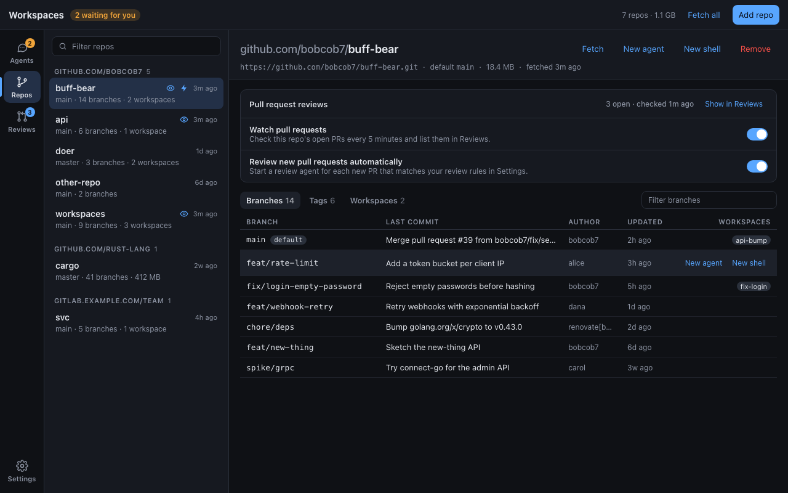
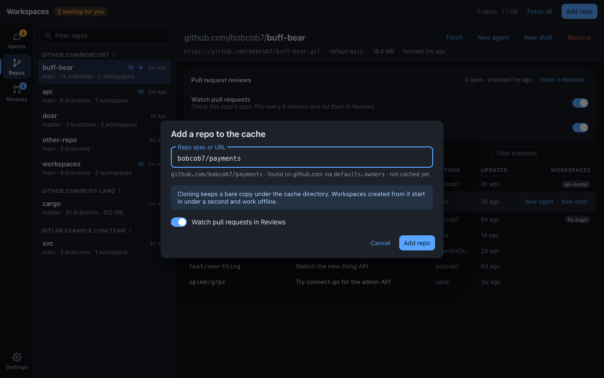
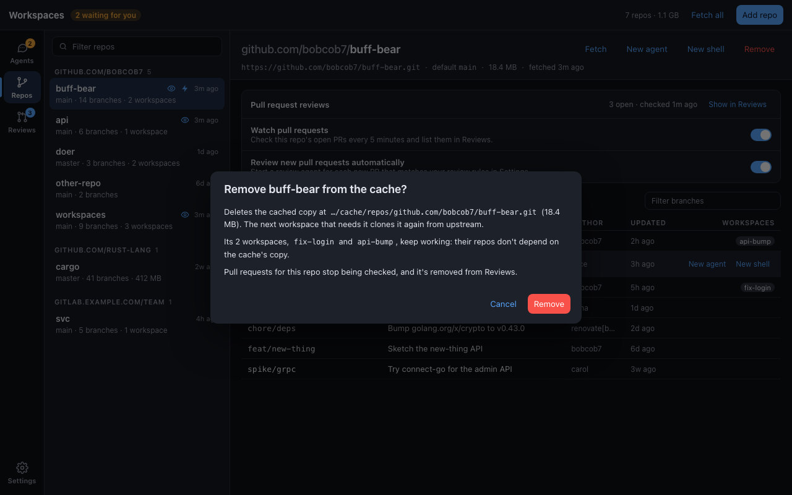

# Repos section: design

List and manage the repos in `ws`'s cache
([ADR 0008](../../adrs/0008-repository-cache.md)) and their branches, and
start work on any of them. Shared frame and rules:
[README.md](README.md).

## List

- One row per cached repo, grouped by `host/owner` (heading with count),
  sorted by name within a group, groups sorted by id.
- Row: repo name, last-fetched age on the right; summary `default branch ·
  N branches · N workspaces` (workspace count omitted when 0; a repo over
  100 MB shows its size instead of the workspace count).
- Small icons after the name, from Reviews: an eye when its pull requests
  are watched, a bolt when auto-review is on. Hidden until Reviews ships.
- A filter box at the top matches repo ids as `ws cache search` does
  (substring, case-insensitive).
- Top bar: `N repos · total size` (muted), **Fetch all**
  (`ws cache update --all`), **Add repo** (contained).

## Detail

Header:

- Title: the id, with `host/owner/` muted and the name bold.
- Actions: **Fetch** (`ws cache update <id>`), **New agent** and **New
  shell** (open the existing dialogs with this repo's spec filled in),
  **Remove** (red; confirms).
- Meta: upstream URL (mono), `default <branch>`, size, `fetched <age>`.
  The cache path is shown on hover of the upstream and copied on click.

Body, top to bottom:

1. **Pull request reviews** card (slot owned by Reviews, see
   [reviews.md](reviews.md)): Watch and Auto-review switches, open PR count,
   last check, **Show in Reviews**. Shown only for GitHub repos.
2. **Tabs**: Branches (default), Tags, Workspaces, each with a count, and a
   filter box on the right.
   - **Branches**: Branch (mono; the default branch first, with a
     `default` chip), Last commit (subject), Author, Updated (age), and
     Workspaces (chips of workspace ids that have this branch checked out;
     clicking one opens it in Agents). Hovering a row replaces the chips
     with **New agent** and **New shell** for `repo@branch`.
   - **Tags**: Tag, commit subject, date, sorted newest first; the same
     hover actions.
   - **Workspaces**: the workspaces with this repo, as Agents rows; click to
     open in Agents.

While a fetch runs, the Fetch button shows a spinner and the meta's age
reads "fetching…"; the branch list refreshes when it ends. A fetch error
shows as an Alert above the tabs with `ws`'s message.

## Add repo

- One field: repo spec or URL, as `ws cache add` accepts
  ([0007](../../adrs/0007-repo-spec-syntax-and-resolution.md)).
- As you type (debounced ~400 ms), `ws cache resolve --json` previews the
  id and how it was found (`source`: spec, cache, default, probe), and
  whether it's already cached. Ambiguous names list the candidates to pick
  from; `repo_not_found` shows under the field and disables **Add repo**.
- A **Watch pull requests in Reviews** switch, shown only once Reviews
  exists and the repo is on GitHub; on by default.
- **Add repo** runs `ws cache add --json`; the dialog stays open with a
  progress bar while it clones, then selects the new repo.

## Remove repo

Confirm dialog saying what happens, from
[`ws cache remove`](../../tools/ws-cache.md#remove): the cached copy and
its size are deleted; the listed workspaces keep working; the next
workspace that needs the repo clones it again; Reviews stops watching it.
**Remove** is red.

## Empty and error states

- No cached repos: "Repos you use in workspaces are cached here so new
  workspaces start fast. Add one to get started." with **Add repo**.
- `ws` missing or failing: the same Alert as Agents.

## What the PR needs to decide

These are for the implementing PR, with an ADR where they're lasting:

1. **Listing branches and tags.** `ws cache list --json` has no refs, and
   `ws cache search --refs` matches names only. Options: a new
   `ws cache refs <spec> --json` subcommand (branch/tag, commit, subject,
   author, date) that keeps git inside `ws`
   ([0003](../../adrs/0003-use-git-cli.md)), or the app running
   `git for-each-ref` on the cache path itself. The first fits 0029's
   "everything through `ws`" and needs an ADR amending
   [0014](../../adrs/0014-command-set.md)'s command set.
2. **Which workspaces use a branch**: join `ws list --json`'s repos
   (`id`, `ref`, `ref_kind`) with the branch list in the app.
3. **How often to read `ws cache list`**: on entering the section and
   after any action, not on the 4 s agent poll; it reads every repo.
4. **Branch actions beyond starting work** (delete a cached branch, prune
   commit refs with `ws cache prune`) are left out of this design; add
   them only if `ws` gains the command.
