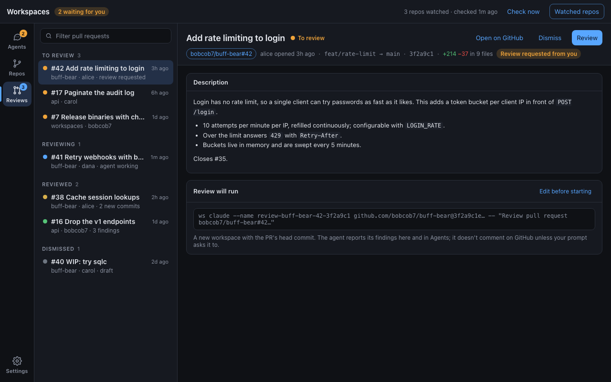
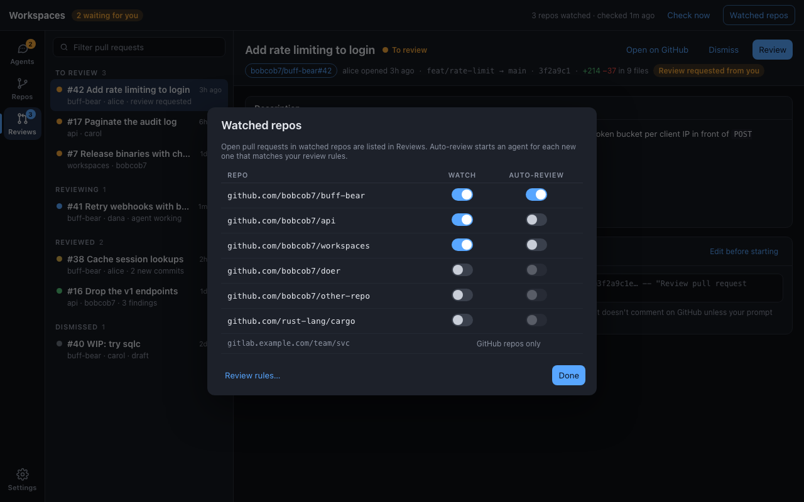
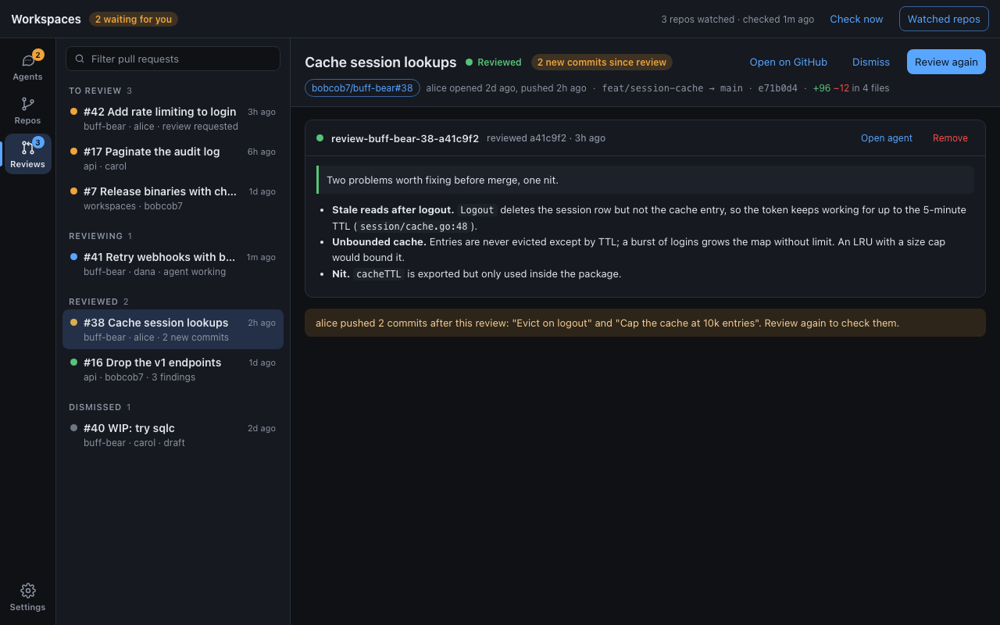
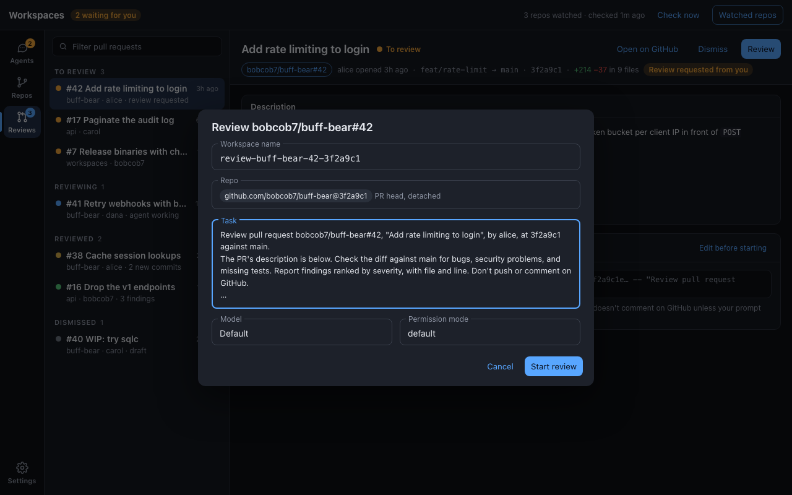
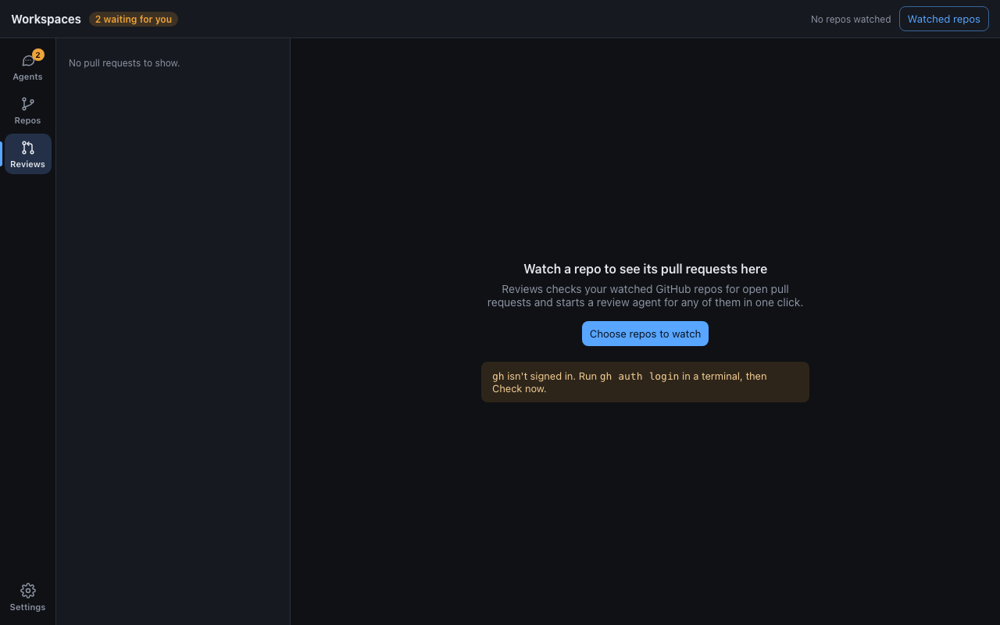

# Reviews section: design

Check the cached GitHub repos you choose for open pull requests, and
review any of them with an agent in one click, or automatically. Shared
frame and rules: [README.md](README.md). What a review agent is and how
the app finds it: [ADR 0032](../../adrs/0032-review-agent-per-pr-head.md).

## Watching repos

- Pull requests are read only for **watched** repos. A repo is watched
  from its Repos detail card, the Add repo dialog, or the **Watched repos**
  dialog in this section's top bar.
- **Auto-review** is a second, per-repo switch, only available on a
  watched repo, off by default.
- Only GitHub repos can be watched; others are listed in the dialog as
  "GitHub repos only".

## Checking

- Every 5 minutes by default (Settings), and on **Check now**, the app runs
  `gh pr list --repo <owner/name> --state open --json …` for each watched
  repo, a few at a time.
- The top bar says `N repos watched · checked <age>`; while a check runs,
  a small spinner. A repo whose check fails keeps its last result and shows
  a warning row in the list: "api: gh: HTTP 404" and so on.
- `gh` missing or signed out is an Alert in the pane saying what to run
  (`brew install gh`, `gh auth login`).
- Checking keeps running while the app is open, whatever section is shown.

## List

Rows are pull requests: `#<number> <title>`, age on the right (since the
last push), summary `repo · author · <extra>`, and a status dot.

| Group       | When ([0032](../../adrs/0032-review-agent-per-pr-head.md))    | Dot   | Extra in summary                         |
| ----------- | ------------------------------------------------------------- | ----- | ---------------------------------------- |
| To review   | no review workspace                                           | amber | `review requested`, `draft`              |
| Reviewing   | review agent working or starting                              | blue  | `agent working`, `needs input`           |
| Reviewed    | review agent idle or stopped                                  | green, or yellow if out of date | `N new commits`, the agent's one-line result |
| Dismissed   | dismissed by you, and no new commits since                    | grey  | `draft`                                  |

- Within a group, newest first. Dismissed is collapsed by default.
- The rail badge counts **To review** plus out-of-date **Reviewed**.
- A filter box matches number, title, author, and repo.
- Closed or merged pull requests drop out on the next check; their review
  workspaces stay in Agents until removed.

## Detail

Header: title; review status; **Open on GitHub**, **Dismiss** (or
**Restore** when dismissed), and the primary action, **Review** / **Review
again**. Meta: `owner/repo#N` (link chip), author and age, `head → base`
(mono), the short head commit, `+adds −dels in N files`, and a chip when
your review is requested.

Body:

- **To review**: the PR description (Markdown, as the conversation renders
  it) and a **Review will run** card showing the `ws claude` command, with
  **Edit before starting**.
- **Reviewing / Reviewed**: a card for the review agent: its name and
  status dot, the commit it reviewed and when, **Open agent** (switches to
  Agents and selects it), **Remove** (`ws rm`). Inside, the agent's result
  (green-edged block) and its reply, as Agents shows a finished agent.
  More than one review (one per pushed commit) lists the newest first,
  older ones collapsed.
- **Out of date**: a warning strip naming the commits pushed since the
  review, and **Review again**.

## Starting a review

**Review** starts it with no dialog, using the Settings defaults.
**Edit before starting** opens the dialog first:

- Workspace name (ADR 0032's name; editable, but changing it means the
  app won't connect the agent to the pull request; say so under the
  field).
- Repo: `id@<sha7>` chip, read-only.
- Task: the review template from Settings with the PR's fields filled in.
- Model and permission mode, defaulting to Settings.
- **Start review** runs `ws claude --json`, then selects the pull request,
  now under Reviewing.

## Auto-review

- On each check, a pull request in an auto-review repo starts a review if
  it has no review at its current head commit, isn't dismissed, and passes
  the rules in Settings (skip drafts, skip your own, only when your review
  is requested).
- At most N auto-reviews run at once (Settings, default 2); the rest wait
  for the next check. Reviews you start by hand don't count against it.
- A pull request reviewed automatically shows "auto" next to its agent's
  name.
- New commits on an auto-reviewed PR start a new review at the new head,
  under the same rules.

## Empty states

- No watched repos: what Reviews does, and **Choose repos to watch**.
- Watched repos, no open pull requests: "No open pull requests in N
  watched repos. Checked <age>."

## Decisions

Settled by the implementing PR:

1. **Where state is kept**: one `desktop.json` in the app's own config
   directory, written only by the Rust backend
   ([0034](../../adrs/0034-desktop-state-file.md)). Dismissals and
   auto-review records are keyed by repo, number, and head commit, and
   pruned once their pull request closes or moves.
2. **How `gh` is run**: with the login shell's PATH, `--repo <cache id>`
   (so the host travels with the id, GitHub Enterprise included), four repos
   at a time, and the interval doubling, up to an hour, after a rate-limited
   check ([0035](../../adrs/0035-desktop-review-checker.md)).
3. **Where checking runs**: a task in the Rust backend, which also starts
   auto-reviews; the frontend reads the joined result on its 4 s poll
   ([0035](../../adrs/0035-desktop-review-checker.md)).
4. **What "done" means**: a review is done when its agent is idle or
   stopped (Reviewed). The summary shown is Claude Code's job result, as in
   Agents, and the card adds the agent's last reply from its transcript.
   The template doesn't ask for a fixed format and the app counts no
   findings; a "3 findings" summary is whatever the agent's result says.
   The template is a setting, so this can change without a new ADR.
5. **Tests**: `cargo test` pins ADR 0032's name format and matching
   (`reviews::names`), the groups (`reviews::view`), every auto-review rule
   and the cap (`reviews::auto`), and checking with fake `gh` and `ws`
   (`reviews::checker`); Vitest covers grouping, filtering, the badge, and
   each component.

### Where the build differs from the mockups

- **Age** is since the pull request's last update, not its last push:
  `gh pr list` can't include `commits` for 100 pull requests (GitHub's
  node limit), so the push time isn't known. The detail meta says "opened
  …, updated …".
- **Needs input** puts a review under Reviewing, with the `needs input`
  summary the table lists, rather than under Reviewed as ADR 0032's
  idle-is-reviewed would.
- **The out-of-date strip** says "2 commits pushed after this review: …",
  not "alice pushed …": the compare API names commit authors, not who
  pushed.
- **Settings** lists only the Reviews group, since a group is shown once it
  has settings.
- **Repos slots** ([repos.md](repos.md#slots-for-reviews)) are filled by
  `RepoReviewsCard` and `features/reviews/RepoSlots.tsx`
  (`RepoReviewsIcons`, `AddRepoWatchSwitch`, `RemoveRepoReviewsNote`).
  A listener follows Repos' `addRepo.fulfilled` (watching the repo when
  its Watch switch was on, for GitHub repos only) and `removeRepo.fulfilled`
  (re-reading the Watched repos list). Removing a repo keeps its switches
  in `desktop.json`, so adding it back watches it again.
