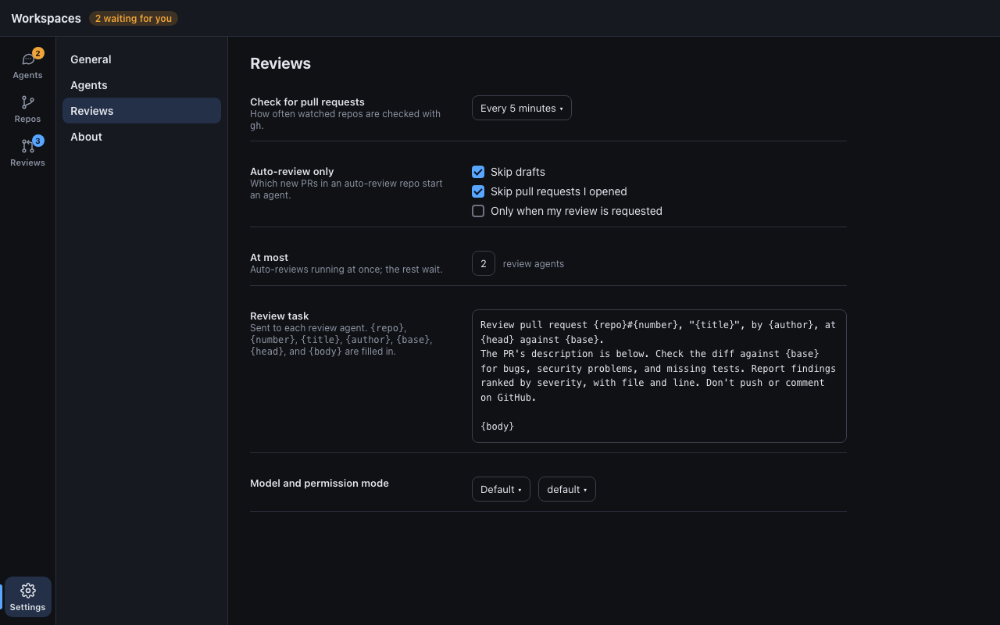

# Settings section: design

A place for the app's own preferences, reached from the bottom of the
rail ([ADR 0031](../../adrs/0031-desktop-sections-rail.md)). It has no
content of its own until a section needs a setting; the Reviews PR adds
the first group. Shared frame and rules: [README.md](README.md).

## Layout

- The list is the settings groups: General, Agents, Reviews, About. A group
  is shown only once it has settings.
- The detail is the group's settings, one per row: a label and a short
  muted explanation on the left (260 px), the control on the right, rows
  separated by a rule. Content is at most 820 px wide.
- Changes apply as you make them; there is no Save button. A setting that
  fails to save shows an error under its control and keeps the old value.
- The top bar has no actions here.

## Groups

| Group   | Settings                                                                 | Added by        |
| ------- | ------------------------------------------------------------------------ | --------------- |
| Reviews | Check interval; auto-review rules (skip drafts, skip my own, only when my review is requested); max auto-reviews at once; review task template; model and permission mode | Reviews PR |
| General | Agent list refresh interval; open at login                               | later           |
| Agents  | Default model and permission mode for New agent; how many attach terminals stay open (now 4) | later |
| About   | `ws` and `claude` versions and paths, `CONFIG_DIR`, the app's version   | later           |

Settings that `ws` owns, such as `defaults.owners` in `config.toml`
([config.md](../../config.md)), aren't edited here unless `ws` gains a
command to set them; the About group may link to the file.
