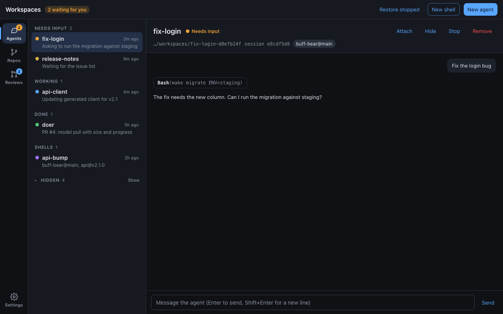
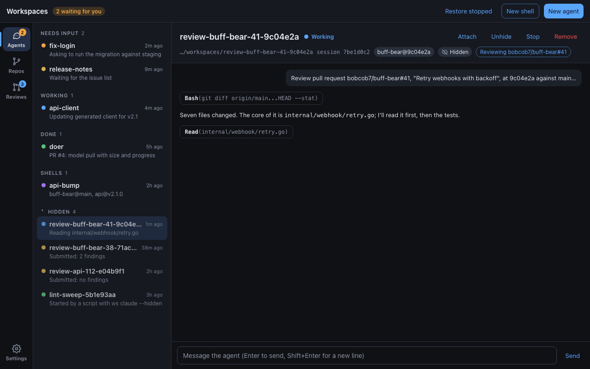

# Hidden workspaces: design

Reviews, and helpers that scripts or agents start, make workspaces the user
isn't following. [ADR 0043](../../adrs/0043-hidden-workspaces.md) lets a
workspace be **hidden**: still a normal workspace for every command, but
left out of `ws list` and the desktop app's Agents list until asked for.
This doc shows what that looks like; the decision and its reasons are in
the ADR. The screenshots are mockups, not the app; see [Mockups](#mockups).

## CLI

```console
$ ws list
ID                   NAME        CREATED   SESSION                  REPOS
fix-login-d8efb24f   Fix login   2m ago    agent e8cdf5d8: idle     buff-bear@main
api-bump-5c01e7a2    api-bump    2h ago    shell                    buff-bear@main, api@v2.1.0
4 hidden workspaces not shown; ws list -a shows them

$ ws list -a
ID                                     NAME                                   CREATED   SESSION                   REPOS
fix-login-d8efb24f                     Fix login                              2m ago    agent e8cdf5d8: idle      buff-bear@main
review-buff-bear-41-9c04e2a-1f0c33d8   review-buff-bear-41-9c04e2a (hidden)   1m ago    agent 7be1d0c2: working   buff-bear@9c04e2a
lint-sweep-5b1e93aa                    lint-sweep (hidden)                    3h ago    agent 0c9e1a7b: idle      api@main
api-bump-5c01e7a2                      api-bump                               2h ago    shell                     buff-bear@main, api@v2.1.0

$ ws claude --hidden --name lint-sweep api -- "Fix every lint warning"
$ ws hide fix-login
fix-login-d8efb24f  hidden
$ ws unhide fix-login
fix-login-d8efb24f  visible
```

- The "not shown" line goes to stderr, so the table stays the only thing
  on stdout. `-q` prints only ids and no such line.
- `ws list --json` gives each workspace `"hidden"` and adds
  `"hidden_count"`, the number left out (0 with `-a`).
- `ws review start` always makes a hidden workspace. `ws review wait`,
  `ws review report`, and `ws rm` take its id as before.

## Desktop app

### Hidden group, collapsed (the default)



- The app runs `ws list --all --json` and splits the result: visible
  entries are grouped as today; hidden ones go in a **Hidden** group,
  always last, collapsed to its heading and count, with **Show** on the
  right. Clicking the heading expands it.
- Hidden entries don't count toward "N waiting for you", the window
  title, or the Agents rail badge. Here two finished reviews are idle
  but the badge still says 2.
- A visible agent's header gets **Hide**, between Attach and Stop. It
  runs `ws hide` and needs no confirmation: Unhide undoes it.

### Hidden group open, a hidden review selected



- Inside the group, entries are sorted by recency like other groups,
  keep their status dots, and are dimmed slightly. Their status still
  shows; it just isn't counted.
- The header shows a **Hidden** chip (eye-off icon) in the meta line and
  **Unhide** in place of Hide.
- Whether the group is open lives in `agentsSlice.showHidden`; not
  persisted, like the section ([desktop-sections](../desktop-sections/README.md#state)).
- Cross-links that select a hidden entry ("Open agent" from a review,
  the requester link in a report) set `showHidden` so the selection is
  visible.
- Selecting an entry, then hiding it, keeps it selected: the pane stays
  and the row moves into the Hidden group, which opens.

### Elsewhere

- **Reviews** is unchanged: it finds review workspaces in the same
  listing, hidden or not.
- **Repos**: workspace counts and the Workspaces column of branches and
  tags include hidden workspaces; they're real checkouts of that ref.

### State and data

- `Entry` gains `hidden: boolean`, from `ws list`'s `hidden` (false for
  background sessions outside any workspace).
- `needsAttention` returns false for hidden entries; `groupEntries`
  ignores them, and the Sidebar renders the Hidden group from
  `entries.filter((e) => e.hidden)`.
- New thunks `hideEntry` and `unhideEntry` call Tauri commands
  `hide_workspace` and `unhide_workspace`, which run `ws hide|unhide
  --json <id>`, then refresh the list.

## Mockups

[`mockups.html`](mockups.html) draws both screens with the app's colors
and type; open it with a hash (`mockups.html#agents-hidden`). The PNGs in
[`img/`](img/) are rendered from it at 1280 × 800:

```console
$ H=$(find ~/Library/Caches/ms-playwright -name chrome-headless-shell -type f | head -1)
$ for s in agents agents-hidden; do
    "$H" --hide-scrollbars --window-size=1280,800 --screenshot="$PWD/img/$s.png" "file://$PWD/mockups.html#$s"
  done
```

## Out of scope

- Hiding shells: `ws shell` has no `--hidden`, though `ws hide` works on
  any workspace.
- Reasons or categories for hiding (labels, origin); see the ADR's
  alternatives.
- Notifying about a hidden agent that needs input.
