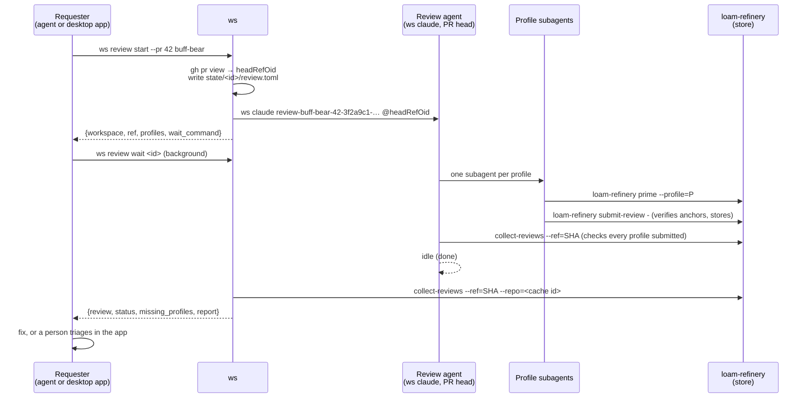

# Reviews with loam-refinery: design

How a review started from `ws` or the desktop app becomes a structured,
multi-reviewer report that the agent who asked for it can act on, and that
a person can triage finding by finding. The reviewing itself is
[loam-refinery](https://github.com/bobcob7/loam-refinery)'s: its review
document, reviewer profiles, verified anchors, store, and
`collect-reviews`. This doc covers how `ws` drives it. The decisions are
ADRs [0037](../../adrs/0037-loam-refinery-as-external-binary.md) to
[0041](../../adrs/0041-desktop-acts-on-findings.md); the desktop screens
are in a follow-up design PR.

## Why

Today a review is a `ws claude` agent with a free-form prompt
([0032](../../adrs/0032-review-agent-per-pr-head.md)). What comes back is
prose: the app shows the agent's job result and last reply, and "counts no
findings" ([reviews.md](../desktop-sections/reviews.md#decisions)). That
leaves three gaps:

1. **No shape.** A finding can't be referred to, sorted, or filtered, and
   there's no telling a hollow "LGTM" from a real review.
2. **One reviewer.** A single prompt asks one agent to look for bugs,
   security problems, and missing tests at once.
3. **No way back.** An agent that wants its own PR reviewed has to start
   the review, find the workspace, and read a transcript. A person who
   wants to post two findings and fix a third has to copy text by hand.

loam-refinery already answers the first two: a review is a JSON document
with addressable comments, numeric priorities, anchors verified against
the commit, and competing suggestions with effort and blast radius; a
**profile** (`architecture`, `claims`, `security`, `tests`, `go`, …)
focuses a reviewer; and `collect-reviews --ref=SHA` combines every stored
review of one commit, each comment qualified as `<profile>:<id>`. What's
missing is the orchestration around it, which is what `ws` is for.

## Overview



### 1. loam-refinery is a tool `ws` runs, not a library it links

The review agent runs `loam-refinery` itself (`prime`, `describe`,
`submit-review`), so the binary has to be on the agent's PATH anyway. `ws`
runs the same binary for `collect-reviews` and never reads the store's
files or database, which loam-refinery says is not a contract. `ws` checks
the version once, the way it checks git and Claude Code. See
[0037](../../adrs/0037-loam-refinery-as-external-binary.md).

### 2. One review agent per PR head; one subagent per profile

0032 stays as it is: a review is one `ws claude` workspace at the PR's
head commit. Its task is now an orchestration prompt embedded in `ws`:
start one Claude Code subagent per requested profile, each of which runs
`loam-refinery prime --profile=<p>`, reviews, and submits with `profile`
set. The orchestrator may add language profiles (`go`, `typescript`) that
match the changed files, then runs `collect-reviews` to check that every
profile submitted, and ends with a short summary as its result. Aggregation
across agents is the store's: every submission for the commit is collected,
whichever agent or workspace made it. See
[0038](../../adrs/0038-review-fans-out-to-profile-subagents.md).

### 3. `ws review`: start, wait, report

A new command, so agents and the app share one path:

```
ws review start [--json] [--name NAME] [--pr N] [--profile P]... [--requester ID|none] <spec> -- [claude flags] [extra instructions]
ws review wait  [--json] [--timeout DURATION] <id>
ws review report [--json] [--format json|markdown|html] (<id> | --repo R --ref SHA)
```

`start` resolves the commit, writes a review record to
`state/<id>/review.toml` (repo, ref, PR, profiles, requester), and starts
the agent. `wait` blocks until the review agent is done and prints the
report; an agent that asked for a review runs it as a background command
and picks the report up when it exits. `report` runs `collect-reviews` and
adds `ws`'s view: the record, the agent's status, and which requested
profiles never submitted. `ws list --json` gains a `review` field. See
[0039](../../adrs/0039-ws-review-command.md).

### 4. The desktop app renders the report itself, and remembers your triage

The Reviews detail pane shows findings from `ws review report --json`,
rendered by the app (not loam-refinery's HTML in a frame), grouped by
priority band, filterable by profile and category, each finding with its
anchors, code, and suggestions side by side. Each profile-qualified finding
takes a decision: **Comment**, **Fix** (with a chosen suggestion), or
**Skip**. Decisions live in `desktop.json`, keyed by repo, PR, commit, and
qualified id. **Open full report** writes the HTML report to a file and
opens it in the browser. See
[0040](../../adrs/0040-desktop-renders-report-and-keeps-triage.md).

### 5. Acting on selected findings

- **Comment** posts one GitHub pull request review with `gh api`, at the
  reviewed commit: a line comment per finding whose anchor is in the diff,
  the rest in the review body. A preview shows exactly what will be posted;
  nothing is posted without confirming it.
- **Fix** sends the selected findings, with the chosen suggestion for each,
  to the agent that requested the review if its session still exists,
  through the app's existing reply path. Otherwise it starts a fix agent on
  the PR's branch.

See [0041](../../adrs/0041-desktop-acts-on-findings.md).

## What changes where

| Area | Change |
| ---- | ------ |
| `internal/refinery/` (new) | The only place `loam-refinery` runs: version check, `prime --list`, `collect-reviews` |
| `internal/review/` (new) | Review records, the orchestration prompt, status and missing-profile checks |
| `internal/cli/review.go` | `ws review start`, `wait`, `report`; `ws llm review` guide |
| `internal/cli/list.go` | `review` field per workspace in `ws list --json` |
| `docs/config.md` | `[review]` keys: `profiles`, `timeout` |
| `desktop/src-tauri/src/reviews/` | Start reviews with `ws review start`; `review_report` command; triage and actions |
| `desktop/src/features/reviews/` | Report view, triage controls, Comment preview, Fix dialog |
| loam-refinery | None required. A tagged release (0.2.0) to pin against is wanted, and its README still says `validate` where the CLI says `submit-review` |

## Build order

1. `internal/refinery` and the version check; `ws review report --repo
   --ref` (useful on its own for reviews submitted by hand).
2. Review records, `ws review start` and `wait`, the orchestration prompt,
   `ws llm review`, and `review` in `ws list`.
3. The desktop app starts reviews with `ws review start`; its task
   template setting becomes "extra instructions".
4. Report view and triage in the desktop app.
5. Comment and Fix.

Each step ships on its own: after step 2, agents can review each other's
work from a terminal with no app at all.

## Out of scope

- Posting anything to GitHub without a person confirming it. Agents get
  the report; only the app posts, and only from the preview.
- Reconciling findings across profiles (deduplicating two profiles'
  versions of one problem). loam-refinery reports them side by side on
  purpose; the app shows anchors that overlap, and leaves the call to you.
- Comparing reviews across commits ("what's new since the last review").
  loam-refinery defers it too.
- GitLab and other forges, as in [reviews.md](../desktop-sections/reviews.md).
