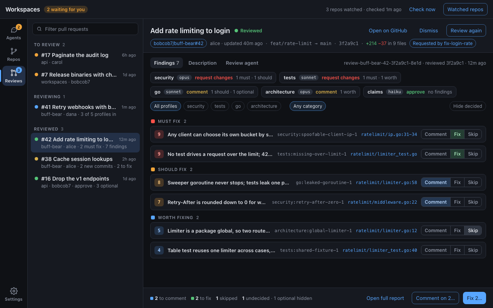
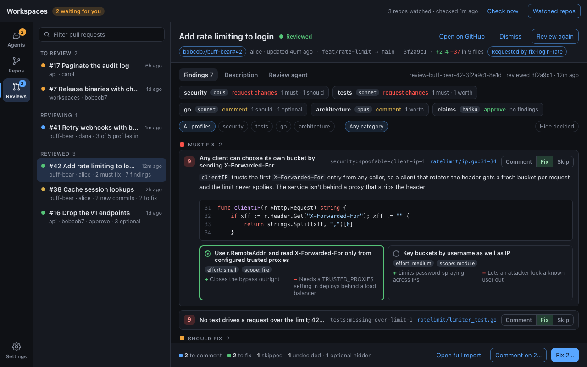
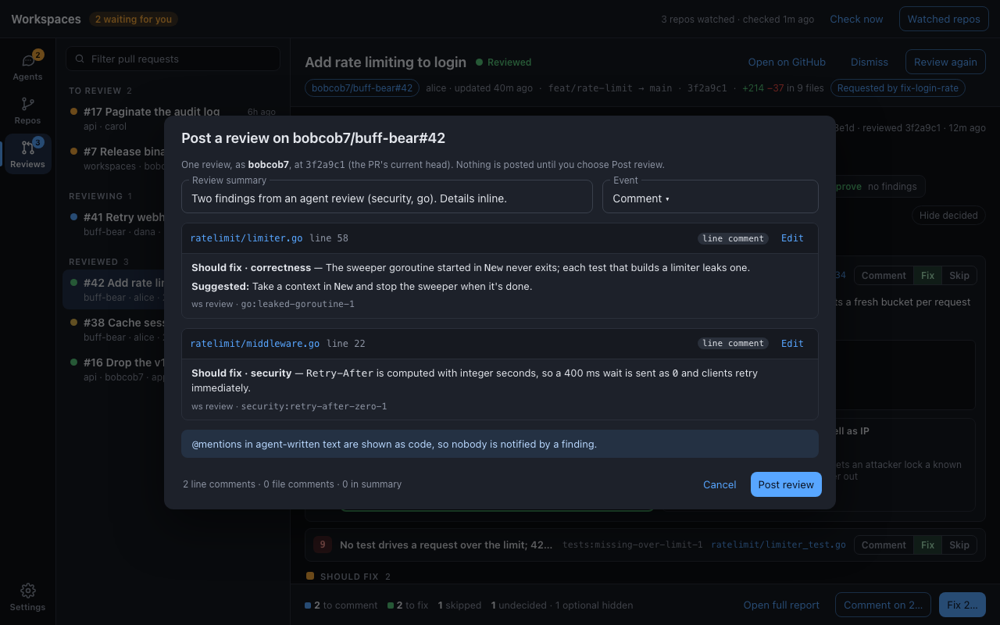
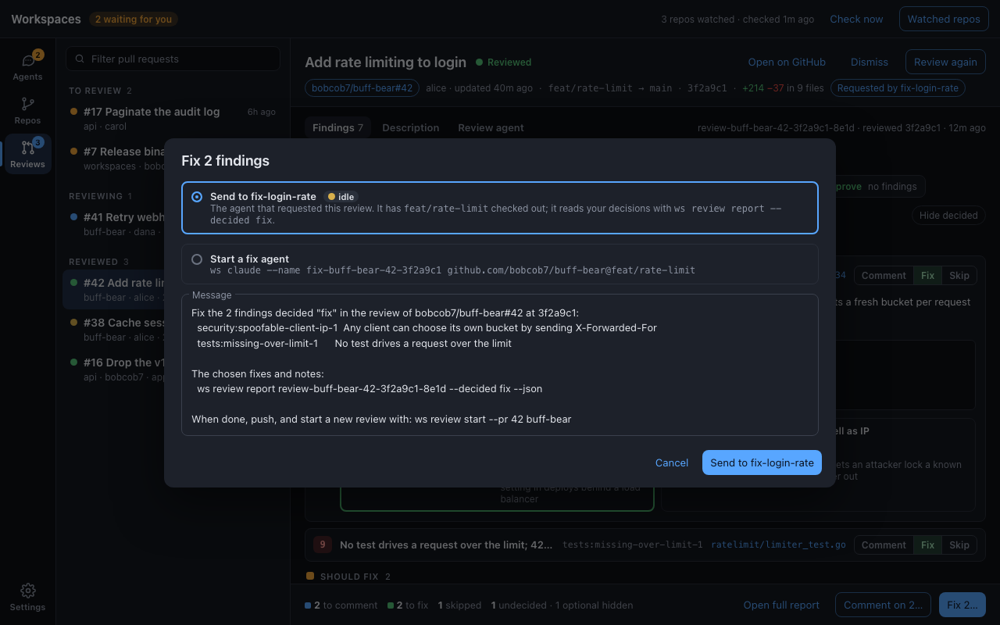
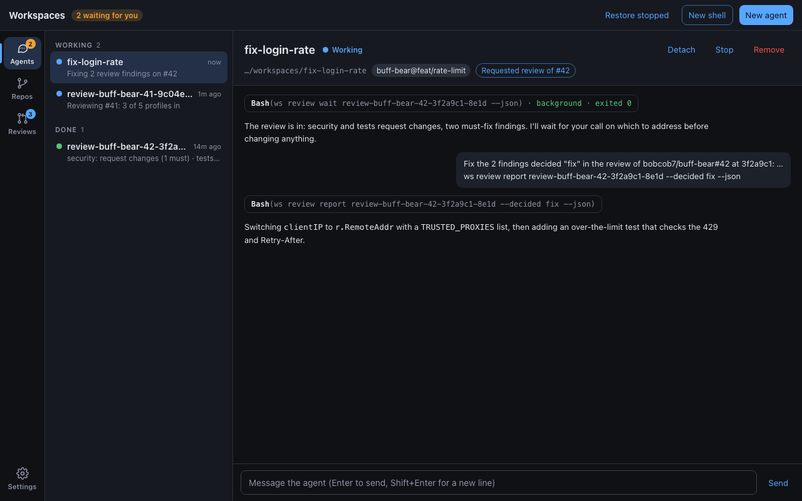
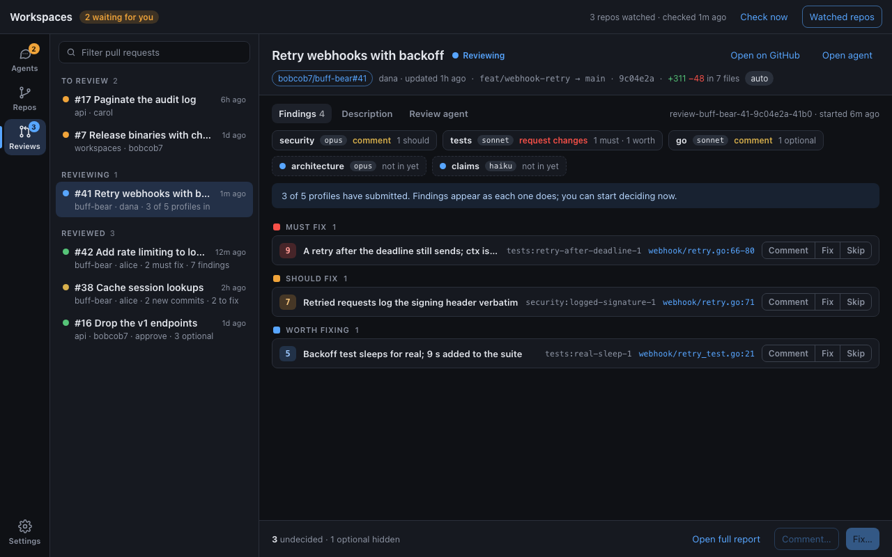
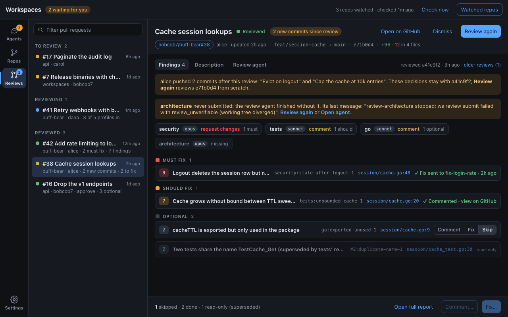
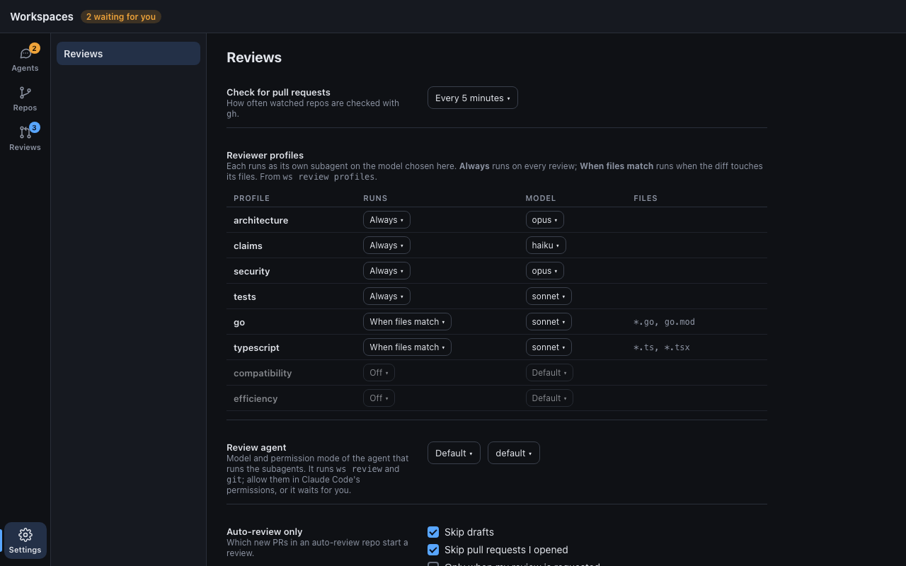

# Review reports in the desktop app: UI/UX

How the Reviews section shows a review and lets you decide,
finding by finding, what to comment on, what to fix, and what to skip.
The flow and decisions behind it are in the [design](README.md) and ADRs
[0039](../../adrs/0039-ws-review-command.md) to
[0041](../../adrs/0041-desktop-acts-on-findings.md). The shared frame
(rail, list, detail, rules every section follows) is unchanged from
[desktop-sections](../desktop-sections/README.md). The screenshots are
mockups, not the app; see [Mockups](#mockups).



## Where it lives

The report replaces the "review agent" card in a pull request's detail
pane ([reviews.md](../desktop-sections/reviews.md#detail)). The pane gets
three tabs:

| Tab | Shows |
| --- | ----- |
| **Findings** (default once a review exists) | The report: profiles, filters, findings, and the action bar |
| **Description** | The PR description, as today |
| **Review agent** | Today's agent card: name, status, Open agent, Remove, its result and last reply |

A pull request with no review yet keeps today's To review layout. The
right of the tab row names the review workspace and the commit it reviewed
(`reviewed 3f2a9c1 · 12m ago`), and links older reviews of the same PR,
newest first.

The header gains one chip: **Requested by `<agent>`** when the review
record names a requester ([0039](../../adrs/0039-ws-review-command.md)).
It's a cross-link: it switches to Agents and selects that agent.

## Profiles strip

One tile per profile in the review record: the name, the model its
subagent ran on, its verdict (red *request changes*, yellow *comment*,
green *approve*), and its findings by band (`1 must · 1 should`).

- A profile with no submission yet is dashed, with a blue dot and "not
  in yet", while the agent works.
- One still missing when the agent is done is dashed and grey,
  "missing", and an amber alert above the strip names it with the agent's
  last message, and offers **Review again** and **Open agent**.
- Clicking a tile filters to that profile; clicking again clears it.

## Findings

Grouped by band, in the review format's priority ladder:

| Band | Priorities | Marker |
| ---- | ---------- | ------ |
| Must fix | 9–10 | red |
| Should fix | 7–8 | amber |
| Worth fixing | 4–6 | blue |
| Optional | 1–3 | grey, collapsed by default ("N optional hidden" in the action bar) |

Within a band, highest priority first, then by profile. Each finding is
one row:

- a priority badge in the band's color;
- the title: the body's first sentence, cut to fit;
- the qualified id (`security:spoofable-client-ip-1`), mono, muted;
- the first anchor (`ratelimit/ip.go:31-34`), a link to that file and
  line at the reviewed commit on GitHub; `+2` when there are more;
- the decision control: **Comment · Fix · Skip**, a segmented button.
  Clicking the selected one again clears it.

Clicking the row (anywhere but the control and the link) expands it:



- the full body (Markdown), and every anchor;
- the code excerpt, if the reviewer gave one, highlighted, with line
  numbers from the anchor;
- the suggestions as cards, two per row: the summary, `effort` and
  `scope` chips, pros (+) and cons (−) side by side. A radio on each card
  chooses the fix; choosing one also sets the decision to **Fix**. No
  choice means "the fixer's choice";
- a note field ("Add a note for the fixer or the comment"), collapsed
  until clicked.

**Decisions are saved as you make them**, with `ws review decide`, in the
review's store ([0040](../../adrs/0040-review-decisions-kept-with-findings.md)).
They survive restarts and removing the review agent, and agents see them
in `ws review report`.

**Read-only findings.** Superseded submissions (a profile that submitted
again) are hidden; **Show superseded** in the filter row's overflow brings
them back, dimmed, with ids like `#2:…` and "read-only" where the control
would be. They can't carry a decision.

**Done findings.** A finding that was acted on shows the result in place
of the control: "✓ Commented · view on GitHub" (a link to the review) or
"✓ Fix sent to `<agent>` · 2h ago" (a cross-link). Clicking it offers
**Act again**, which puts the decision back.

### Filters

Under the profiles: profile chips, then category chips (*Any category*,
correctness, security, …, only those present), and on the right **Hide
decided**. Filters are per pull request and kept for the session. With
any filter on, the band headings show `2 of 4` instead of the count, so
a filtered list doesn't read as a short review.

### Keyboard

↑/↓ move between findings, Enter or Space expands, **C**, **F**, and
**S** set Comment, Fix, and Skip, **1**–**9** choose a suggestion on the
expanded finding, and Backspace clears the decision.

## Action bar

Pinned to the bottom of the Findings tab:

- the tally: `2 to comment · 2 to fix · 1 skipped · 1 undecided`, each
  with the decision's color, and "N optional hidden";
- **Open full report**: `ws review report --format html` written to the
  app's cache and opened in the browser;
- **Comment on N…** and **Fix N…**, disabled at zero. Fix is the primary
  button: fixing is the usual next step.

## Comment on N…



A wide dialog showing exactly what will be posted
([0041](../../adrs/0041-desktop-acts-on-findings.md)):

- who and where: "One review, as `<login>`, at `<sha7>`", and, when the
  reviewed commit isn't the head any more, an amber line saying the
  comments may show as outdated on GitHub;
- **Review summary**, editable, prefilled with the count and profiles,
  plus any findings that can't be placed on a line or file;
- **Event**: Comment (default), Request changes, or Approve;
- one card per comment with its path and line, its kind (line comment,
  file comment), and the text as GitHub will render it, each with
  **Edit**;
- the counts by kind, next to **Cancel** and **Post review**.

Posting shows a spinner on the button; success closes the dialog, marks
the findings done, and shows a Snackbar with **View on GitHub**. A failure
keeps the dialog open with `gh`'s message in an Alert, and posts nothing.

## Fix N…



- **Target**, two options:
  - **Send to `<requester>`**, with its status dot, when the record names
    a requester whose session exists. Default. Disabled with a reason
    ("removed", "stopped: resume it first") otherwise.
  - **Start a fix agent**, with the `ws claude` command it will run (on
    the PR's branch, or a `fix/pr-<n>-<sha7>` branch for a fork PR).
    Model and permission mode come from the Reviews settings.
- **Message**: the text that will be sent, editable. It stays short:
  the findings' ids and titles, and `ws review report <review> --decided
  fix --json`, which gives the agent the full findings with your chosen
  fixes and notes; then `ws review start` for the next review.
- **Send to `<requester>`** or **Start fix agent**. After sending, the
  findings show as done, and a Snackbar offers **Open agent**.

The requester sees the message as a user turn in its conversation:



## While a review runs



The Findings tab appears as soon as the first profile submits; the
report is re-read every 30 s while the agent works
([0040](../../adrs/0040-review-decisions-kept-with-findings.md)).
A blue Alert says "3 of 5 profiles have submitted…", and decisions can be
made already. Comment and Fix stay disabled until the agent is done, so a
fix isn't sent while findings are still arriving. The list row's summary
reads `3 of 5 profiles in`.

## Out of date, incomplete, and done



- **Out of date**: the amber strip names the commits pushed since,
  and says the decisions stay with the reviewed commit. **Review again**
  starts a review at the new head; its findings start undecided, with
  "decided at `<sha7>`" next to any id decided in an older review.
- **Incomplete**: the missing-profile Alert, above the strip.
- The list row's summary for a reviewed PR is the worst band and the
  decisions left: `2 must fix · 7 findings`, then `2 to fix` once you've
  decided, then `all done`.

## Settings



The Reviews group changes in three places:

- **Reviewer profiles** is a table of every profile `ws review profiles`
  lists, built in or added under `CONFIG_DIR/review/profiles/`:
  - **Runs**: *Always*, *When files match* (with the profile's patterns,
    such as `*.go, go.mod`, shown beside it), or *Off*.
  - **Model**: *Default* (the review agent's), an alias (`opus`,
    `sonnet`, `haiku`, `fable`), or a full model id typed in.

  The table starts from `ws`'s defaults and `config.toml`. Changes are
  kept in `desktop.json` and passed to every review as `--profile
  NAME:MODEL` and `--auto NAME:MODEL`
  ([0038](../../adrs/0038-review-fans-out-to-profile-subagents.md)).
  **Reset to defaults** under the table drops them.
- **Review task is removed.** `ws review` writes the review's prompt
  itself, so a template isn't needed. A request for focus belongs to one
  review, not every one: **Edit before starting** keeps a *Focus* field
  for that, which goes after `--` as `ws review start`'s focus text.
- **Review agent** holds the model and permission mode of the agent that
  starts the subagents. Its hint says it runs `ws review` and `git`, so
  they must be allowed or it waits for you.

## Empty and error states

| State | Shows |
| ----- | ----- |
| A profile's subagent failed to submit | The profile's tile is "missing" and the Alert quotes the review agent's last message, which names `ws`'s error (`review_unverifiable`, `review_invalid`) |
| Review finished, no submissions | "The review agent finished without submitting a review." with **Open agent** and **Review again** |
| Every profile approves, no findings | Green "No findings from 5 profiles." with the profiles strip |
| `ws review report` fails | Alert with `ws`'s error code and message; the Review agent tab still works |

## Mockups

[`mockups.html`](mockups.html) draws each screen with the app's colors and
type, reusing the base styles of
[desktop-sections/mockups.html](../desktop-sections/mockups.html). Open
it with a hash (`mockups.html#report-fix`). The PNGs in [`img/`](img/)
are rendered from it at 1280 × 800:

```console
$ H=$(find ~/Library/Caches/ms-playwright -name chrome-headless-shell -type f | head -1)
$ for s in report report-finding report-comment report-fix report-reviewing report-outdated report-requester report-settings; do
    "$H" --hide-scrollbars --window-size=1280,800 --screenshot="$PWD/img/$s.png" "file://$PWD/mockups.html#$s"
  done
```

## Tests (for the implementing PR)

- Vitest: band grouping and order, filters and the `2 of 4` headings,
  the read-only rule, the decision control (set, clear, suggestion sets
  Fix), the tally, keyboard shortcuts, and that Comment and Fix are
  disabled while the agent works.
- `cargo test`: covered by 0040 and 0041 (triage store, placement, fix
  message).
