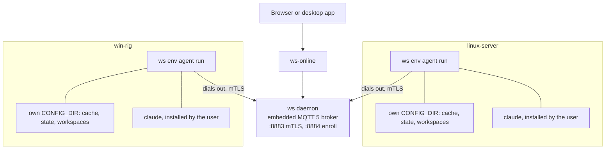

# Design: remote environments

Decisions: [0072](../../adrs/0072-remote-environments.md),
[0073](../../adrs/0073-environment-agent-is-ws.md),
[0074](../../adrs/0074-mqtt-transport-embedded-broker.md),
[0075](../../adrs/0075-environment-enrollment-and-certificates.md),
[0076](../../adrs/0076-environment-platforms-and-phasing.md),
[0078](../../adrs/0078-reviews-and-loops-on-environments.md).

Task lists and measurements: [PR 4's tasks](tasks-ui.md) with its
[constraints](constraints-ui.md), the [reviews and loops tasks](tasks-rl.md) with their [constraints](constraints-rl.md), and the [terminal spike](terminal-spike.md). The Loops-by-environment wireframe is below.

## Picture



Every workspace has one environment. `ws machine spawn` inside a remote
workspace runs the remote's own `ws`, so the child is on the same machine.

## Enrolling

```
$ ws env add linux-server
Code (works once, shown once):
  ws-enroll-v1.eyJoIjoid3MuZXhhbXBsZS5jb206ODg4NCIs...

On linux-server:
  ws env agent enroll ws-enroll-v1.eyJoIjoid3Mu...
  ws env agent run            # or install the service: see docs/tools/ws-env.md
```

## Settings › Environments (desktop and Workspace Online)

```
Environments                                              [ Add environment ]
┌───────────────────────────────────────────────────────────────────────────┐
│ ● local          this machine                                             │
│ ● linux-server   online   ws 0.31  linux/amd64   claude 2.4 signed in     │
│                  4 workspaces                          [ Rotate ] [ Remove ]│
│ ○ win-rig        offline since 14:02  (last seen)      [ Rotate ] [ Remove ]│
│ ◌ nas            waiting for enrollment                       [ Cancel ]  │
└───────────────────────────────────────────────────────────────────────────┘
claude: missing  -> "Install Claude Code on this machine, then try again."
```

Add environment: a name field, then the code and the two commands to copy,
showing it once. When the agent connects, the row turns
green on its own.

## New agent dialog

```
New agent
  Repos        [ buff-bear@main                 ]
  Environment  [ linux-server               v ]     local
                                                      linux-server
  Prompt       [ ...                            ]     win-rig  (offline, disabled)
```

The picker remembers the last choice; offline environments are disabled
with their reason. For a child of a workspace there's no picker: it shows
"Runs on linux-server, like its parent".

## Agents list

Each row gets a small environment badge unless it's `local`. A filter chip
row lists environments with their online dots. An offline environment's
rows are dimmed with "offline" and keep their last known status; their
actions (attach, stop, remove) are disabled with the reason.

## Loops by environment

```
Loops                                  [ local | linux-server | win-rig ]  [ New loop ]
● local
  nightly-deps      every 24h   next 02:00
● linux-server      online
  triage            every 1h    next 14:30   last run ok
○ win-rig           offline (last seen 14:02), dimmed
  Loops on win-rig don't run while it is offline; missed runs are skipped,
  not made up.
  build-watch       every 1h    next 14:30   Run now, Edit, Delete disabled
```

The list reads the snapshot (`ws loop list --env <name> --cached`), so it
works offline. Saving a script or `bypassPermissions` on a remote asks first:
"This script runs as the agent's user on linux-server, every 1h, outside
Claude Code's permissions." ([0078](../../adrs/0078-reviews-and-loops-on-environments.md))

## Failure messages

| Situation | Message |
| --- | --- |
| Start on an offline environment | `win-rig is offline (last seen 14:02). Nothing was started.` |
| Child with a different environment than its parent | `environment_mismatch: this workspace is a child of one on linux-server` |
| Agent older than the controller | `environment linux-server runs ws 0.28, which speaks protocol 0; workspace.create needs protocol 1`. The wording is the one built; see [0072](../../adrs/0072-remote-environments.md)'s amendments for D5's proposal |
| Claude Code missing on the remote | `claude isn't installed on linux-server.` |
| Code already used | `That code was already used. Run ws env rotate linux-server for a new one.` |
