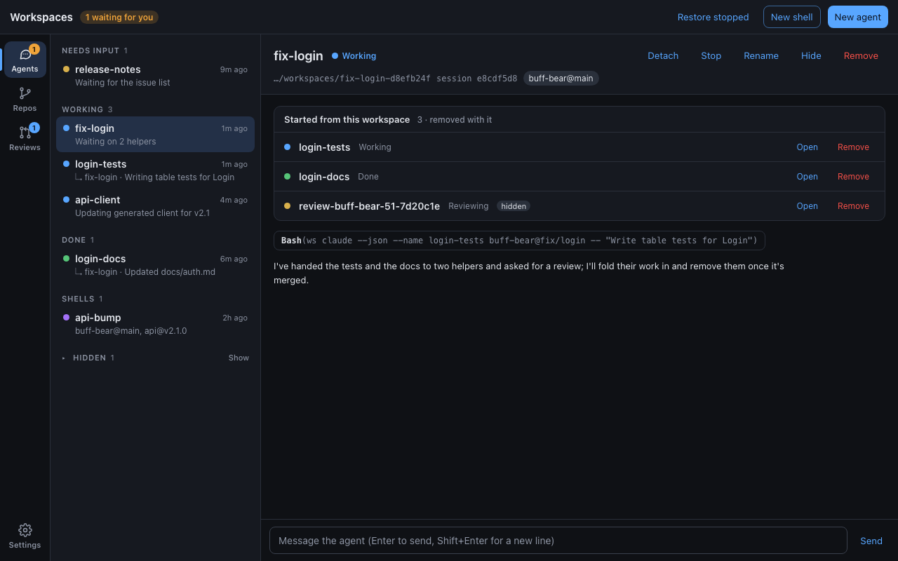
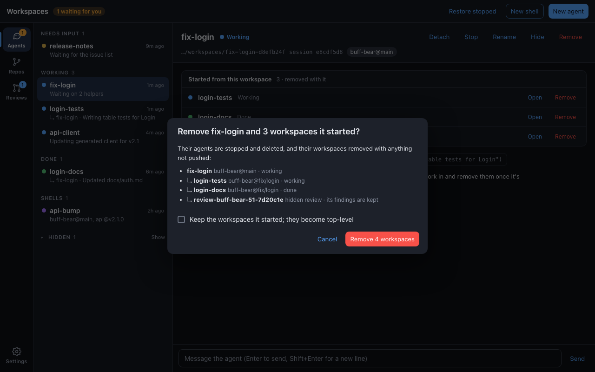
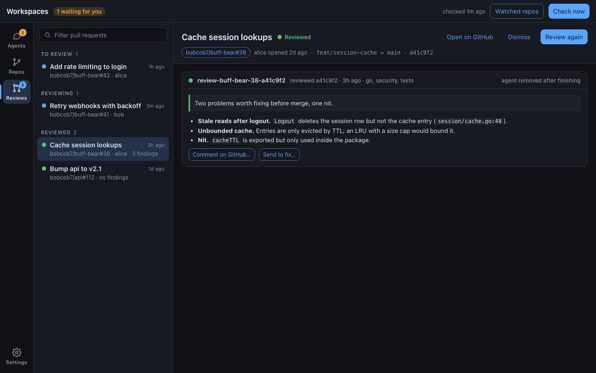

# Workspace trees and finished reviews: design

Agents start helpers and reviews. [ADR 0044](../../adrs/0044-workspace-trees.md)
records which workspace started which, and removes a workspace's
descendants with it. [ADR 0045](../../adrs/0045-finished-reviews-are-removed.md)
removes a review's agent and workspace once every reviewer has reported,
keeping the review itself in the store. This doc shows both in the CLI and
the desktop app; the decisions and their reasons are in the ADRs. The
screenshots are mockups, not the app; see [Mockups](#mockups).

## CLI

An agent working in `fix-login-d8efb24f` starts a helper and a review the
usual way; both become its children:

```console
$ ws claude --json --name login-tests buff-bear@fix/login -- "Write table tests for Login"
{"id":"login-tests-3be0a9c1","session":"0c9e1a7b","parent":"fix-login-d8efb24f",…}
$ ws review start --json --pr 51 buff-bear
{"id":"review-buff-bear-51-7d20c1e-1f0c33d8","parent":"fix-login-d8efb24f",…}

$ ws list -a
ID                                       NAME                                   CREATED   SESSION                   REPOS
fix-login-d8efb24f                       Fix login                              40m ago   agent e8cdf5d8: working   buff-bear@main
└ login-tests-3be0a9c1                   login-tests                            1m ago    agent 0c9e1a7b: working   buff-bear@fix/login
└ login-docs-a71f0e22                    login-docs                             6m ago    agent 9d1b44e0: idle      buff-bear@fix/login
└ review-buff-bear-51-7d20c1e-1f0c33d8   review-buff-bear-51-7d20c1e (hidden)   1m ago    agent 7be1d0c2: working   buff-bear@7d20c1e
api-bump-5c01e7a2                        api-bump                               2h ago    shell                     buff-bear@main, api@v2.1.0

$ ws list --json --parent fix-login-d8efb24f   # its direct children

$ ws rm --dry-run fix-login-d8efb24f
fix-login-d8efb24f                      would be removed
└ login-tests-3be0a9c1                  would be removed
└ login-docs-a71f0e22                   would be removed
└ review-buff-bear-51-7d20c1e-1f0c33d8  would be removed

$ ws rm --keep-children fix-login-d8efb24f   # its children become top-level
```

- The parent is the workspace `ws` runs in, found from the working
  directory, as the review requester already is. `ws claude --parent
  <WORKSPACE>|none` overrides it; `ws review start --requester none`
  starts a review with no parent.
- A grandchild is indented once more (`  └ `).
- `ws rm` and the removal pass remove descendants deepest first. A child
  that can't be removed, such as a running shell, keeps itself and its
  ancestors, and says why in its item.

Finished reviews go on their own:

```console
$ ws review wait --json review-buff-bear-51-7d20c1e-1f0c33d8
{"repo":"github.com/bobcob7/buff-bear","ref":"7d20c1e…","agent":null,…}   # agent null: already removed

$ ws review list --json --repo github.com/bobcob7/buff-bear
{"reviews":[
  {"id":"review-buff-bear-51-7d20c1e-1f0c33d8","review":{…},"agent":null},
  {"id":"review-buff-bear-41-9c04e2a-1f0c33d8","review":{…},"agent":{"workspace":"review-buff-bear-41-9c04e2a-1f0c33d8","status":"working"}}
],"warnings":[]}
```

### What agents are told

`ws llm` gains a rule and a section on trees:

> - What you start from your workspace (`ws claude`, `ws review start`) is
>   your child, and is removed when your workspace is. Remove each child
>   with `ws rm` as soon as you've used its result; list them with
>   `ws list --json --parent <your workspace>`. Use `--parent none` only
>   for work meant to outlive you.
> - Reviews remove themselves once every reviewer has reported; read the
>   report with `ws review wait`, which works after removal.

## Desktop app

### A parent and its children



- A child's row keeps its place in the status groups; its summary starts
  with `↳ <parent>` so the link is visible without nesting rows, which
  would split a tree across status groups.
- A parent's pane gets a **Started from this workspace** card, between
  the header and the conversation, listing each child with its status,
  a hidden chip where it applies, **Open** (selects it, opening the
  Hidden group if needed), and **Remove**. The heading says the children
  are removed with the parent.
- A child's header meta gets a `↳ fix-login` chip that selects the
  parent.
- `Entry` gains `parentId: string | null`; children are found by
  `parentId` in the listing, so no extra command is run.

### Removing a parent



- The Remove dialog lists the workspace and every descendant with its
  repos and status, says reviews' findings are kept, and titles the
  action with the count ("Remove 4 workspaces").
- **Keep the workspaces it started** runs `ws rm --keep-children`.
- Removal runs `ws rm` once; per-item failures from its result show in a
  Snackbar naming what was kept.

### A reviewed pull request whose review was removed



- The app reads `ws review list --json` with each check, alongside
  `ws list`, and matches runs to pull requests by `review.pr.number`. A
  run that also has a workspace is the same review, shown once.
- A run with `agent: null` shows **agent removed after finishing** where
  **Open agent** and **Remove** were; the report, comments, and fixes
  work as before, since they read `ws review report --repo --ref`.
- The pull request stays in **Reviewed**, and auto-review doesn't start
  it again: the run counts as a review at that head.

## Mockups

[`mockups.html`](mockups.html) draws the three screens with the app's
colors and type; open it with a hash (`mockups.html#agents-remove`). The
PNGs in [`img/`](img/) are rendered from it at 1280 × 800:

```console
$ H=$(find ~/Library/Caches/ms-playwright -name chrome-headless-shell -type f | head -1)
$ for s in agents-tree agents-remove reviews-removed; do
    "$H" --hide-scrollbars --window-size=1280,800 --screenshot="$PWD/img/$s.png" "file://$PWD/mockups.html#$s"
  done
```

## Out of scope

- Moving a workspace to another parent after creation; `--keep-children`
  and `--parent none` cover keeping work.
- Removing helpers automatically when they finish: unlike a review,
  `ws` can't tell a finished helper from one waiting for its parent.
- Keeping a removed review agent's conversation.
