# Roadmap: independence from any one model or provider

The long-term goal: **`ws` depends on no particular model, provider or
agent harness**, Claude Code and Anthropic included. Claude Code becomes
one optional runner among several; it isn't being replaced. The decision
and the review rules that keep work aligned with it are in
[ADR 0071](adrs/0071-claude-code-default-runner-as-peer.md). This page has
no dates: a phase ends when its exit criteria hold.

This is the long-term direction. The README's
[Roadmap](../README.md#roadmap) tracks the commands as they're built.

## Principles

- **Don't disrupt what works.** Claude Code is the default and the
  supported path. A start with the default runner never depends on the
  runner, the `ws` daemon, runner config or an endpoint.
- **Evidence-gated.** A role or command moves only after measured runs
  show it works as well as on Claude, and the owner decides. Each move is
  undone by config.
- **Opt-in per role.** Anything may choose the runner (`--runner ws`,
  `[runner.roles.<role>]`, a loop's `runner`); nothing is moved for it.
- **No automatic fallback** between runners, ever.

## Phases

```mermaid
flowchart LR
    p0["0. Today: Claude Code everywhere"]
    p1["1. Runner for low-risk roles (verifier, docs-only implementer) on qwen/qwen3.5-9b, measured"]
    p2["2. More roles, ws claude and loops on the runner; MCP and parity gaps closed"]
    p3["3. More providers (Ollama-native, Anthropic Messages, OpenAI Responses); runner-hosted orchestrator and designer"]
    p4["4. A ws-native session model, not tied to claude --bg"]
    p5["5. Independence: Claude Code optional"]
    p0 -->|"this PR ships"| p1
    p1 -->|"verifiers and docs tasks match Claude in measured runs"| p2
    p2 -->|"code roles measured; no blocking parity gap"| p3
    p3 -->|"orchestrated runs complete without Claude Code"| p4
    p4 -->|"every people-facing feature works for every runner"| p5
```

| Phase | What changes | To move on | Stays on Claude meanwhile | Risks |
| ----- | ------------ | ---------- | ------------------------- | ----- |
| **0. Today** | Every agent is a Claude Code background session | The runner design (ADRs 0062–0071) is built | Everything | One harness and one provider's usage limits |
| **1. This PR** | The runner, daemon, OpenAI-compatible provider, MCP client; verifiers and docs-only `small` implementers on `qwen/qwen3.5-9b` by config or `--runner ws` | The [measured-run plan](design/ollama-agent/README.md#which-roles-suit-a-9b-model): verifiers agree with Claude's verdicts in 3 of 3 runs, then docs-only implementers need at most one Claude respawn in three; the `claude-default-untouched` regression passes | Orchestrator, designer, code implementers, the reviewer gate, the screenshot child, people's agents, review agents | A 9B model fails more than it helps; runner bugs in supervision |
| **2. More roles** | Advisory reviewer, then code implementers by size; `ws claude --runner ws` and loops used for real; skills, hooks, permission rules, WebFetch and image input from the parity matrix's `later` rows; each `never` row revisited (below) | Measured success per role against Claude on the same tasks; cost per task (GPU minutes vs Claude usage) recorded in run logs; no `never` row blocks a role being moved | The reviewer gate, orchestrator, designer, interactive `ws claude` | Parity work grows faster than use; a small model's failures cost more Claude respawns than they save |
| **3. More providers** | `api = "ollama"` (next), `anthropic` (Messages API, so Claude models run through the runner without Claude Code), `openai-responses`; then an orchestrator and a designer hosted on the runner, first on a strong model through `anthropic` | Orchestrated runs finish end to end with no Claude Code process, at a success rate the owner accepts; each provider passes the fake-based e2e suite | Interactive sessions, review agents, `ws restart`/`ws continue` | Provider differences (thinking blocks, tool-call formats) leak above the `Provider` seam |
| **4. ws-native sessions** | Listing, attach, send and continue, usage-limit handling, restart, review agents and the desktop's transcripts and Stats work for runner sessions through the daemon, not through `claude --bg` | Every feature in the inventory below has a runner implementation or an owner decision that it stays Claude-only | Whatever the inventory still marks Claude-only | A second session model to maintain; the desktop's attach needs a terminal protocol of `ws`'s own |
| **5. Independence** | Claude Code is optional: `ws` installs, runs and passes its tests without it; the default runner becomes a config choice | The owner chooses the default | Nothing by necessity | Losing what Claude Code adds for free as it evolves |

**Parity `never` rows to revisit in phase 2** (from
[0069](adrs/0069-runner-mcp-tools-and-claude-code-parity.md)): attach,
send and continue (**a real blocker** for people's agents and the
desktop; phase 4); permission prompts and auto mode (**a blocker** only
for interactive use; unattended runs don't need them); plan mode (a
blocker for an interactive designer, not for an unattended one); slash
commands and custom commands (not a blocker: roles and skills cover
them); memory (not a blocker: roles and loop memory); NotebookEdit,
WebSearch built in, status line and output styles (not blockers).

## Where `ws` is tied to Claude Code today

The inventory to untangle, mostly in phase 4:

| Coupling | Where |
| -------- | ----- |
| A workspace lives as long as its Claude Code session | [0015](adrs/0015-workspace-lifetime-follows-session.md) |
| `ws restart` swaps Claude Code's background service and respawns sessions | [0018](adrs/0018-restart-claude-daemon.md) |
| Sessions read by `kind`, `pid`, `status` through one client that needs Claude Code 2.1.302 | [0024](adrs/0024-claude-code-client.md), `internal/claude` (the only place `claude` runs and its transcripts are read) |
| `ws claude` hands off to `claude --bg` and becomes `claude attach` | [0025](adrs/0025-ws-claude-session-hand-off.md) |
| `ws continue` resumes agents stopped by Claude's usage limit | [0047](adrs/0047-ws-continue-after-usage-limit.md) |
| A review is a `ws claude` agent with one Claude Code subagent per profile | [0032](adrs/0032-review-agent-per-pr-head.md), [0038](adrs/0038-review-fans-out-to-profile-subagents.md) |
| The desktop's conversation view and attach follow Claude Code transcripts | [0030](adrs/0030-desktop-conversation-from-transcript.md) |
| Stats read Claude Code's transcripts | [0059](adrs/0059-stats.md) |
| `ws llm` tells agents to follow children with `claude logs`; role files' `model` is a Claude alias | `internal/cli/guides/`, `internal/machine/role/roles/` |

The runner design already removes some of these for runner sessions
([0063](adrs/0063-runner-children-are-supervised-sessions.md): listing,
`wait`, `ws machine logs`, resume by the daemon); the rest stay
Claude-only until their phase.
